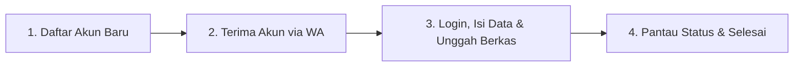

# Panduan Penggunaan Portal PMB PPG — Calon Mahasiswa (Pendaftar)
**Institut Agama Kristen Negeri (IAKN) Palangka Raya**  
*Program Pendidikan Profesi Guru (PPG) Dalam Jabatan Bimas Kristen*

---

## Daftar Isi
1. [Pengenalan Portal & Ketentuan Umum](#1-pengenalan-portal--ketentuan-umum)
2. [Alur Utama Pendaftaran (Ringkasan)](#2-alur-utama-pendaftaran-ringkasan)
3. [Langkah 1: Pendaftaran Akun Baru (Pencocokan SK via WhatsApp)](#3-langkah-1-pendaftaran-akun-baru-pencocokan-sk-via-whatsapp)
4. [Langkah 2: Menerima Username & Password dari Operator](#4-langkah-2-menerima-username--password-dari-operator)
5. [Langkah 3: Masuk ke Akun (Login) & Mengakses Ruang Kerja](#5-langkah-3-masuk-ke-akun-login--mengakses-ruang-kerja)
6. [Langkah 4: Mengisi Formulir Biodata Pendaftaran (5 Tahap)](#6-langkah-4-mengisi-formulir-biodata-pendaftaran-5-tahap)
7. [Langkah 5: Mengunggah Berkas Dokumen Persyaratan](#7-langkah-5-mengunggah-berkas-dokumen-persyaratan)
8. [Langkah 6: Meninjau Data, Menyetujui Pernyataan & Mengirim Pendaftaran](#8-langkah-6-meninjau-data-menyetujui-pernyataan--mengirim-pendaftaran)
9. [Langkah 7: Memantau Status Pemeriksaan & Melakukan Perbaikan Data](#9-langkah-7-memantau-status-pemeriksaan--melakukan-perbaikan-data)
10. [Langkah 8: Mencetak Bukti Pendaftaran](#10-langkah-8-mencetak-bukti-pendaftaran)
11. [Keamanan Akun & Pengaturan Profil](#11-keamanan-akun--pengaturan-profil)
12. [Pertanyaan yang Sering Diajukan (FAQ) & Bantuan](#12-pertanyaan-yang-sering-diajukan-faq--bantuan)

---

## 1. Pengenalan Portal & Ketentuan Umum

Portal Penerimaan Mahasiswa Baru (PMB) PPG IAKN Palangka Raya merupakan sistem satu pintu resmi untuk memproses verifikasi berkas, pencocokan kepesertaan Surat Keputusan (SK) resmi, pengisian biodata, dan pemantauan administrasi pendaftaran mahasiswa PPG Dalam Jabatan.

### Ketentuan Dasar:
- **Kepesertaan Berbasis SK**: Pendaftaran ini diperuntukkan bagi guru yang namanya tercantum dalam Surat Keputusan (SK) resmi penetapan mahasiswa PPG Dalam Jabatan dari Kementerian Agama RI / Ditjen Bimas Kristen.
- **Standar Waktu**: Seluruh jadwal pembukaan, penutupan, batas perbaikan, dan layanan verifikasi menggunakan **Waktu Indonesia Barat (WIB / Asia/Jakarta, UTC+7)**.
- **Satu Akun, Satu Pendaftaran**: Setiap peserta hanya dapat memiliki satu akun resmi dan satu pendaftaran aktif pada periode/gelombang yang sama.
- **Perangkat yang Direkomendasikan**: Komputer/laptop atau ponsel pintar dengan peramban (*browser*) modern yang stabil (Google Chrome, Mozilla Firefox, Microsoft Edge, atau Safari) dengan koneksi internet yang lancar.

---

## 2. Alur Utama Pendaftaran (Ringkasan)

Proses pendaftaran dirancang dalam **4 langkah utama** yang mudah dan transparan:



1. **Pendaftaran Akun Baru**: Calon peserta mengisi formulir pendaftaran awal di portal dengan mencocokkan identitas SK dan nomor WhatsApp aktif.
2. **Pengiriman Akun oleh Operator**: Operator resmi PMB memverifikasi kecocokan identitas dengan SK, lalu mengirimkan **Username** dan **Password** resmi ke nomor WhatsApp peserta.
3. **Login & Kelengkapan Formulir**: Pendaftar masuk ke akun di portal, melengkapi formulir biodata (identitas, alamat, pendidikan asal), dan mengunggah dokumen persyaratan.
4. **Pemeriksaan & Informasi Lanjutan**: Operator memeriksa berkas. Pendaftar memantau status sampai dinyatakan **Diterima Lengkap** dan dapat mencetak Bukti Pendaftaran.

---

## 3. Langkah 1: Pendaftaran Akun Baru (Pencocokan SK via WhatsApp)

Pendaftaran akun dilakukan secara mandiri melalui website portal PMB tanpa perlu memiliki akun terlebih dahulu.

### Langkah-langkah:
1. Buka website resmi PMB di: `http://ppg.test/` (atau alamat domain resmi kampus).
2. Di halaman beranda, klik tombol emas **Pendaftaran** atau menu **Daftar Akun Baru** (`/klaim-whatsapp`).
3. Anda akan diarahkan ke formulir **Pendaftaran Akun & Pencocokan SK**.
4. Isi data pendaftaran dengan teliti:

| Kolom Formulir | Petunjuk Pengisian |
| --- | --- |
| **Periode Penerimaan** | Pilih periode/gelombang yang berstatus aktif dan sedang dibuka (contoh: *PPG Tahun 2026 Gelombang 1*). |
| **Nama Persis Sesuai SK** | Masukkan nama lengkap Anda persis sesuai yang tercantum pada dokumen SK penetapan resmi (huruf besar/kecil dan ejaan harus sama). |
| **Nomor WhatsApp Aktif** | Masukkan nomor WhatsApp utama yang aktif di ponsel Anda (contoh: `081234567890` atau `6281234567890`). |
| **Pengenal Resmi SK / No. Peserta** | Masukkan nomor peserta PPG atau nomor SK jika ada (termasuk angka nol di depan jika tertera pada SK). |
| **Pernyataan Pemeriksaan** | Baca naskah pernyataan kebenaran data, lalu centang kotak persetujuan. |

> [!IMPORTANT]
> **Pastikan Nomor WhatsApp Anda Benar-benar Aktif dan Bisa Dihubungi!**  
> Username dan password akun Anda akan dikirimkan secara langsung oleh panitia melalui pesan WhatsApp ke nomor yang Anda daftarkan di sini. Jika nomor salah atau tidak aktif, Anda tidak akan menerima akses akun portal.

5. Klik tombol **Ajukan Permohonan**.
6. Simpan **Nomor Referensi Pendaftaran** yang muncul di layar (contoh: `CLM-2026-XXXX`). Nomor ini berguna sebagai tanda bukti jika Anda memerlukan bantuan ke panitia (*helpdesk*).

---

## 4. Langkah 2: Menerima Username & Password dari Operator

Setelah permohonan diajukan, tim panitia/operator PMB PPG IAKN Palangka Raya akan memeriksa data Anda terhadap daftar peserta SK resmi.

1. **Pemeriksaan Operator**: Operator memvalidasi kesesuaian nama dan nomor peserta Anda.
2. **Pengiriman Kredensial Resmi**: Setelah disetujui, operator menerbitkan akun Anda dan mengirimkan pesan resmi WhatsApp berisi:
   - **Alamat Portal Masuk**: `http://ppg.test/masuk`
   - **ID Login / Username**: (biasanya berupa format nama unik Anda, misal: `budi.santoso`)
   - **Kata Sandi (Password) Sementara**: Dibuat aman oleh sistem.
3. **Peringatan Keamanan**:
   - Panitia resmi **tidak pernah memungut biaya apapun** di luar ketentuan resmi kampus.
   - Jangan pernah menyerahkan password akun Anda kepada orang lain.
   - Simpan kredensial ini di catatan pribadi yang aman.

---

## 5. Langkah 3: Masuk ke Akun (Login) & Mengakses Ruang Kerja

Setelah menerima username dan kata sandi dari operator:

1. Buka halaman masuk di: `http://ppg.test/masuk` (atau klik tombol **Masuk Akun** di navigasi portal).
2. Masukkan **ID Login atau Email** Anda.
3. Masukkan **Kata Sandi**.
   > [!TIP]
   > Anda dapat menekan **Ikon Mata** (`bi-eye` / `bi-eye-slash`) di sebelah kanan kolom kata sandi untuk memeriksa apakah sandi yang Anda ketik sudah benar dan tidak ada salah ketik huruf kapital atau angka.
4. Anda dapat mencentang opsi **Ingat saya (tetap masuk)** pada perangkat pribadi Anda.
5. Klik tombol **Log In**.
6. Anda akan langsung diarahkan ke halaman **Ruang Kerja Calon Mahasiswa** (`/ruang-kerja`):
   - **Pemberitahuan Status**: Banner informasi penerimaan dan periode aktif.
   - **Layanan Akademik & Tautan Penting**: Tombol akses langsung ke portal perkuliahan terkait (*LMS PPG IAKN, UKIN Kemdikbud, Website Resmi IAKN Palangka Raya*).
   - **Menu Pendaftaran Saya**: Akses pengisian biodata, unggah berkas, dan bukti pengiriman.

---

## 6. Langkah 4: Mengisi Formulir Biodata Pendaftaran (5 Tahap)

Di ruang kerja Anda, klik menu **Pendaftaran Saya** (`/pendaftar/pendaftaran`), lalu pilih gelombang aktif dan klik **Lengkapi Formulir**. Formulir terdiri dari 5 tahapan yang runtut:

```
[Tahap 1: Identitas] ➔ [Tahap 2: Alamat] ➔ [Tahap 3: Info Tambahan] ➔ [Tahap 4: Pendidikan Asal] ➔ [Tahap 5: Tinjau & Kirim]
```

### Tahap 1 — Identitas Diri & Kontak
Isi identitas diri Anda sesuai KTP/KK yang sah:
- **Nama Lengkap Biodata**: Nama lengkap resmi Anda beserta gelar (jika ada).
- **Jenis Kelamin**: Pilih *Laki-laki* atau *Perempuan*.
- **Tempat Lahir & Tanggal Lahir**: Sesuai akta lahir / KTP. Tanggal lahir harus sebelum hari ini.
- **NIK (Nomor Induk Kependudukan)**: Wajib tepat **16 digit angka**, tanpa spasi atau tanda strip `-`.
- **NISN**: Nomor Induk Siswa Nasional (jika ada, 10 digit; jika tidak ada boleh dikosongkan).
- **Agama & Kewarganegaraan**: Pilih dari daftar referensi resmi.
- **Nama Ibu Kandung**: Masukkan nama ibu kandung dengan teliti sesuai Kartu Keluarga (KK).
- **Nomor WhatsApp & Email**: Kontak aktif untuk pemberitahuan lanjutan.

### Tahap 2 — Alamat Tempat Tinggal
- **Jalan dan Nomor Rumah**: Alamat domisili tempat tinggal Anda saat ini.
- **RT / RW & Dusun**: Isi nomor RT/RW jika ada (1–5 angka).
- **Provinsi, Kabupaten/Kota, Kecamatan, dan Kelurahan/Desa**:
  > [!IMPORTANT]
  > **Cara Memilih Wilayah**:  
  > Ketik beberapa huruf nama provinsi/kota/kecamatan pada kotak pencarian, lalu **KLIK salah satu hasil yang muncul pada daftar dropdown**. Jika Anda hanya mengetik nama tanpa mengeklik hasilnya, data wilayah tidak akan tersimpan. Pilih secara berurutan: Provinsi ➔ Kota/Kabupaten ➔ Kecamatan ➔ Desa/Kelurahan.
- **Jenis Tinggal & Alat Transportasi**: Pilih dari opsi referensi yang tersedia (misal: *Bersama Orang Tua, Rumah Pribadi, Kendaraan Pribadi, dll*).

### Tahap 3 — Informasi Tambahan & Bantuan Sosial
- **Penerima KPS (Kartu Perlindungan Sosial)**: Pilih secara tegas **Ya** atau **Tidak**.
- **Nomor KPS**: Jika Anda memilih *Ya*, wajib memasukkan nomor kartu KPS. Jika memilih *Tidak*, kosongkan kolom ini.
- **NPWP**: Nomor Pokok Wajib Pajak (opsional, jika Anda memiliki).
- **Kebutuhan Khusus**: Pilih opsi dari daftar referensi (pilih *Tidak ada* jika tidak memiliki kebutuhan khusus).

### Tahap 4 — Pendidikan Asal (S1)
- **Perguruan Tinggi Asal**: Ketik nama kampus S1 Anda pada kolom pencarian, lalu **klik nama perguruan tinggi resmi** dari daftar hasil.
- **Program Studi Asal**: Setelah kampus terpilih, ketik nama program studi S1 Anda dan **klik nama program studi yang sesuai**.
- *Catatan*: Program studi terhubung langsung dengan perguruan tinggi yang dipilih. Jika kampus diubah, Anda wajib memilih ulang program studinya.

> [!TIP]
> **Draf disimpan otomatis.** Setelah berhenti mengetik sekitar 700 ms, aplikasi menyimpan perubahan. Tunggu indikator **Draf tersimpan** sebelum menutup halaman. **Selanjutnya**, **Kembali**, dan **Lanjut ke Berkas** menunggu simpan terakhir selesai. Gunakan **Simpan sekarang** atau **Coba simpan lagi** bila diperlukan.
>
> Saat koneksi gagal, jangan tutup tab sebelum penyimpanan berhasil. Jika muncul konflik tab/perangkat lain, salin dahulu isian yang belum tersimpan sebelum memuat ulang. Menyimpan draf bukan berarti pendaftaran sudah dikirim.

---

## 7. Langkah 5: Mengunggah Berkas Dokumen Persyaratan

Selain melengkapi isian teks, pendaftar wajib mengunggah dokumen persyaratan administrasi melalui portal.

### Cara Mengunggah Berkas:
1. Di ruang kerja pendaftaran Anda, buka menu **Berkas Saya** (`/pendaftar/berkas/{period}`).
2. Perhatikan daftar kategori berkas yang disarankan oleh panitia kampus, antara lain:
   - *Ijazah Asli S1 / D-IV*
   - *Transkrip Nilai Asli*
   - *Surat Keputusan (SK) Pengangkatan / Pembagian Tugas Mengajar Terbaru*
   - *Pakta Integritas Mahasiswa PPG (bermeterai)*
   - *Surat Izin Belajar dari Kepala Sekolah / Pimpinan Satuan Pendidikan*
   - *Surat Keterangan Berbadan Sehat & Bebas Narkoba*
   - *Pas Foto Resmi (Latar Belakang Merah/Sesuai Ketentuan)*
3. **Ketentuan Format & Ukuran Berkas**:
   - Format yang diterima: **PDF, JPG, JPEG, PNG**.
   - Ukuran per berkas maksimal: Biasanya **2 MB s/d 5 MB** (perhatikan label batas ukuran di layar).
   - Pastikan pindaian (*scan*) dokumen tampak jelas, tegak, terbaca dengan baik, dan tidak terpotong.
4. **Prosedur Unggah**:
   - Pilih Kategori Berkas yang sesuai (atau *Berkas Persyaratan Lainnya*).
   - Klik tombol **Pilih File** dari komputer/ponsel Anda.
   - Klik tombol **Unggah Berkas**.
   - Berkas akan masuk ke tabel daftar dokumen Anda.

### Aksi pada Berkas yang Telah Diunggah:
- **Lihat / Pratinjau**: Membuka dokumen untuk memastikan halaman berkas sudah benar dan jelas.
- **Unduh**: Mengunduh kembali salinan berkas ke perangkat Anda.
- **Ubah Nama**: Mengganti label nama dokumen jika ingin memperjelas (contoh: `Ijazah_S1_Budi_Santoso.pdf`).
- **Hapus / Lepas**: File yang belum pernah dikirim dapat dihapus permanen. File yang pernah dikirim hanya dilepas dari draf perbaikan; riwayat revisinya tetap disimpan. File terkunci selama pemeriksaan dan dapat diubah kembali ketika status Perlu Perbaikan.

---

## 8. Langkah 6: Meninjau Data, Menyetujui Pernyataan & Mengirim Pendaftaran

Setelah biodata lengkap dan berkas terunggah:

1. Di ringkasan biodata, tekan **Lanjut ke Berkas**. Anda juga dapat membuka halaman berkas dari ruang kerja.
2. Periksa kesiapan biodata. Tautan pada pesan isian belum lengkap membuka bagian formulir yang perlu diperbaiki.
3. Unggah berkas sesuai panduan dan tunggu sampai file tercantum sebagai tersimpan. Selesaikan, coba ulang file gagal, atau batalkan antrean unggah yang tidak dilanjutkan.
4. Periksa **Berkas yang akan dikirim**, kemudian tekan **Periksa & Kirim Pendaftaran**.
5. Baca modal konfirmasi, periksa ringkasan, dan centang pernyataan yang berlaku. Jika belum mengunggah file, perhatikan peringatannya dan baca kembali panduan.
6. Tekan **Kirim Pendaftaran**. Halaman Status Pendaftaran menampilkan hasil pengiriman. Biodata dan berkas dikunci selama pemeriksaan; pengiriman ulang tersedia setelah operator meminta perbaikan.
7. Pendidikan terakhir menentukan riwayat wajib: S1; S1 dan S2; atau S1, S2, dan S3. Setiap jenjang memiliki perguruan tinggi, program studi, dan tahun lulus.

---

## 9. Langkah 7: Memantau Status Pemeriksaan & Melakukan Perbaikan Data

Setelah formulir dikirim, Anda dapat memantau status secara berkala melalui Ruang Kerja.

### Makna Status Pendaftaran:

| Status Pendaftaran | Arti Status | Tindakan Pendaftar |
| --- | --- | --- |
| **Draf** | Formulir masih dalam proses pengisian pribadi dan belum dikirim ke panitia. | Lengkapi isian dan klik *Kirim Pendaftaran* sebelum periode ditutup. |
| **Terkirim** | Formulir dan berkas telah masuk ke antrean operator pemeriksa. Formulir terkunci. | Pantau portal secara berkala untuk melihat hasil verifikasi. |
| **Diverifikasi** | Pemeriksaan awal telah dicatat oleh operator penugasan. | Menunggu penetapan akhir kelengkapan berkas. |
| **Perlu Perbaikan** | Operator menemukan data atau berkas yang belum sesuai/kurang jelas. | **Wajib Diperbaiki**: Buka formulir, baca catatan perbaikan operator, ubah data/berkas, dan kirim ulang. |
| **Diterima Lengkap** | Seluruh biodata dan berkas telah dinyatakan sah, valid, dan lengkap. | **Selamat!** Pendaftaran Anda berhasil. Silakan unduh dan cetak Bukti Pendaftaran resmi. |

### Cara Mengirimkan Perbaikan:
Jika status Anda berubah menjadi **Perlu Perbaikan**:
1. Buka halaman Pendaftaran Saya. Di sana akan tertera kotak catatan berwarna kuning dari operator (contoh: *"Scan ijazah buram, mohon unggah ulang dengan scan warna yang jelas"*).
2. Klik tombol **Perbaiki Formulir / Berkas**.
3. Perbaiki kolom atau unggah ulang berkas yang diminta pada catatan operator.
4. Simpan draf, lalu masuk ke tab **Tinjau & Kirim**.
5. Centang kembali pernyataan persetujuan dan klik **Kirim Ulang Pendaftaran**.
6. Status Anda akan kembali menjadi **Terkirim** dengan nomor revisi yang bertambah (misal: *Revisi 2*).

---

## 10. Langkah 8: Mencetak Bukti Pendaftaran

Setelah Anda berhasil mengirim pendaftaran (dan terutama setelah dinyatakan *Diterima Lengkap*):

1. Di menu **Pendaftaran Saya**, klik tombol **Bukti Pendaftaran** (`/pendaftar/bukti/{period}`).
2. Lembar Bukti Pendaftaran resmi akan terbuka, memuat:
   - Kop resmi Institut Agama Kristen Negeri (IAKN) Palangka Raya.
   - Nomor Pendaftaran PMB resmi (`PMB-XXXX-XXXX`).
   - Nomor Kepesertaan SK dan Nama sesuai SK.
   - Biodata lengkap peserta (NIK, TTL, Jenis Kelamin, Kontak WhatsApp).
   - Data Pendidikan Asal (Perguruan Tinggi & Program Studi).
   - Tanggal dan Jam pengiriman pertama (WIB).
   - Status keputusan pendaftaran dan nomor revisi.
3. Klik tombol **Cetak / Simpan PDF**.
4. Pada kotak dialog printer komputer Anda:
   - Pilih printer fisik untuk mencetak di kertas, atau
   - Pilih *Destination: Save as PDF* untuk menyimpannya sebagai file PDF di perangkat Anda.
5. Simpan dokumen PDF tersebut sebagai arsip resmi kepesertaan Anda.

---

## 11. Keamanan Akun & Pengaturan Profil

Pendaftar dapat mengelola informasi akun secara mandiri melalui menu **Akun & Keamanan**:

- **Mengubah Nama Tampilan**: Buka `/akun`. Anda dapat memperbarui nama tampilan akun Anda. (Catatan: Mengubah nama tampilan profil tidak mengubah data resmi pada SK atau biodata pendaftaran).
- **Mengganti Kata Sandi**:
  1. Buka `/akun/keamanan`.
  2. Masukkan kata sandi saat ini.
  3. Masukkan kata sandi baru (minimal 12 karakter; kombinasikan huruf besar, huruf kecil, dan angka).
  4. Masukkan ulang kata sandi baru untuk konfirmasi.
  5. Gunakan ikon mata (`bi-eye`) untuk memastikan ketikan tidak keliru.
  6. Klik **Simpan Kata Sandi**.

---

## 12. Pertanyaan yang Sering Diajukan (FAQ) & Bantuan

### Q1: Apakah semua orang bisa mendaftar di portal PMB PPG IAKN?
> **Jawaban**: Tidak. Portal ini khusus melayani pendaftaran guru yang telah terdaftar dalam Surat Keputusan (SK) resmi penetapan mahasiswa PPG Dalam Jabatan dari Kementerian Agama / Ditjen Bimas Kristen.

### Q2: Bagaimana jika nomor WhatsApp saya ganti atau hilang?
> **Jawaban**: Segera hubungi Helpdesk resmi PMB PPG IAKN Palangka Raya. Petugas operator akan melakukan verifikasi identitas ulang (mencocokkan NIK, KTP, dan SK) sebelum memperbarui nomor kontak resmi pada akun Anda.

### Q3: Mengapa tombol "Kirim Pendaftaran" belum bisa diklik?
> **Jawaban**: Pastikan seluruh syarat berikut terpenuhi:
> 1. Status pendaftaran SK Anda sudah disetujui operator (memiliki nomor PMB resmi).
> 2. Seluruh kolom wajib pada Tahap 1 s/d Tahap 4 sudah terisi lengkap dan sah.
> 3. Anda telah mencentang kotak pernyataan persetujuan di Tahap 5.
> 4. Periode pendaftaran masih berada dalam rentang jadwal buka (WIB).

### Q4: Apakah status "Diterima Lengkap" berarti pendaftaran saya sudah berhasil?
> **Jawaban**: **Benar**. Status "Diterima Lengkap" menandakan seluruh pemeriksaan biodata dan dokumen administrasi Anda telah disetujui penuh oleh panitia PMB. Anda resmi terdaftar sebagai calon mahasiswa PPG IAKN Palangka Raya.

### Q5: Ke mana saya dapat menghubungi panitia jika mengalami kendala?
> **Jawaban**:  
> - **Kontak Helpdesk**: Periksa nomor WhatsApp resmi pengelola pada kartu *Kontak & Layanan* di halaman depan website.
> - **Waktu Layanan**: Hari kerja sesuai jam layanan resmi (WIB).
> - Sebutkan **Nama Lengkap**, **Nomor SK / No. Peserta**, dan **Nomor Referensi Pendaftaran** Anda saat mengirim pesan ke panitia.
