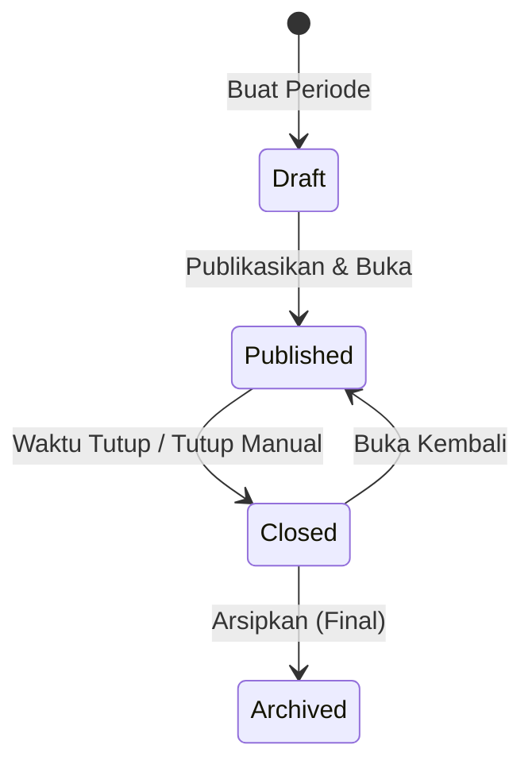
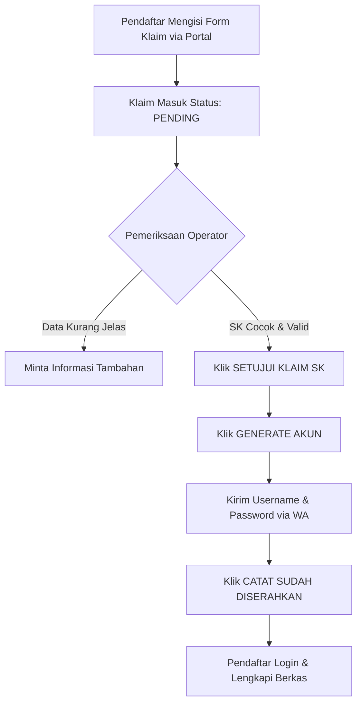

# Panduan Penggunaan Portal PMB PPG — Pengelola (Administrator & Operator)
**Institut Agama Kristen Negeri (IAKN) Palangka Raya**  
*Program Pendidikan Profesi Guru (PPG) Dalam Jabatan Bimas Kristen*

---

## Daftar Isi
1. [Pendahuluan & Arsitektur Hak Akses Pengelola](#1-pendahuluan--arsitektur-hak-akses-pengelola)
2. [Matriks Menu & Kewenangan Akun](#2-matriks-menu--kewenangan-akun)
3. [Panduan Administrator: Manajemen Periode & Gelombang](#3-panduan-administrator-manajemen-periode--gelombang)
4. [Panduan Administrator: Referensi Data & Naskah Pernyataan](#4-panduan-administrator-referensi-data--naskah-pernyataan)
5. [Panduan Administrator: Pengaturan Berkas Persyaratan & Daftar Unggahan](#5-panduan-administrator-pengaturan-berkas-persyaratan--daftar-unggahan)
6. [Panduan Administrator: Pengaturan Aplikasi, Pengumuman & Tautan Cepat](#6-panduan-administrator-pengaturan-aplikasi-pengumuman--tautan-cepat)
7. [Panduan Administrator: Impor Data Peserta SK](#7-panduan-administrator-impor-data-peserta-sk)
8. [Panduan Administrator: Pembagian & Penugasan Operator](#8-panduan-administrator-pembagian--penugasan-operator)
9. [Panduan Operator: Pemeriksaan Klaim & Penyerahan Akun via WhatsApp](#9-panduan-operator-pemeriksaan-klaim--penyerahan-akun-via-whatsapp)
10. [Panduan Operator: Verifikasi Formulir & Pemeriksaan Berkas Persyaratan](#10-panduan-operator-verifikasi-formulir--pemeriksaan-berkas-persyaratan)
11. [Panduan Administrator: Penanganan Kasus Khusus & Pemulihan](#11-panduan-administrator-penanganan-kasus-khusus--pemulihan)
12. [Panduan Administrator: Audit Aktivitas & Ekspor Data](#12-panduan-administrator-audit-aktivitas--ekspor-data)
13. [Standar Operasional Prosedur (SOP) & Checklist Harian](#13-standar-operasional-prosedur-sop--checklist-harian)
14. [Matriks Pemecahan Masalah (Troubleshooting)](#14-matriks-pemecahan-masalah-troubleshooting)

---

## 1. Pendahuluan & Arsitektur Hak Akses Pengelola

Aplikasi PMB PPG IAKN Palangka Raya memisahkan peran pengguna secara ketat guna menjamin integritas data SK resmi dan keamanan administrasi penerimaan.

### Karakteristik Utama Sistem:
- **Prinsip Berbasis SK Resmi**: Seluruh alur pendaftaran berlandaskan daftar peserta resmi yang telah ditetapkan oleh Kementerian Agama / Ditjen Bimas Kristen dan diimpor oleh Administrator.
- **Isolasi Beban Kerja Operator**: Operator hanya dapat mengakses, memeriksa, dan memverifikasi peserta yang secara resmi ditugaskan kepadanya oleh Administrator.
- **Pencatatan Audit Penuh**: Setiap tindakan administratif (persetujuan klaim, penyerahan akun WhatsApp, verifikasi berkas, penetapan keputusan, perubahan jadwal, dan ekspor) terekam otomatis dalam sistem audit log.
- **Zona Waktu Standar**: Seluruh pencatatan waktu dan batas operasional menggunakan **Waktu Indonesia Barat (WIB / Asia/Jakarta, UTC+7)**.

---

## 2. Matriks Menu & Kewenangan Akun

| Menu & Fitur Aplikasi | URL Rute | Operator | Administrator | Keterangan |
| --- | --- | :---: | :---: | --- |
| **Ruang Kerja (Dashboard)** | `/ruang-kerja` | Ya | Ya | Menampilkan statistik dan ringkasan tugas |
| **Peserta SK** | `/peserta-sk` | Terbatas | Penuh | Sesuai penugasan (Operator) / Seluruh SK (Admin) |
| **Klaim & WhatsApp** | `/klaim` | Ya | Ya | Pencocokan pendaftaran & penyerahan akun via WA |
| **Antrean Verifikasi** | `/verifikasi` | Ya | Ya | Verifikasi biodata dan berkas persyaratan |
| **Pengaturan Berkas** | `/admin/aturan-berkas` | Tidak | Ya | Mengatur syarat dokumen, batas ukuran, dan format |
| **Daftar Unggahan Berkas** | `/admin/aturan-berkas/unggahan` | Ya | Ya | Memantau seluruh file dokumen yang diunggah peserta |
| **Periode & Gelombang** | `/admin/periode` | Tidak | Ya | Mengatur jadwal buka/tutup, status draf/publik |
| **Impor SK** | `/admin/impor` | Tidak | Ya | Mengunggah template Excel daftar peserta SK resmi |
| **Pembagian Operator** | `/admin/penugasan` | Tidak | Ya | Menugaskan peserta SK kepada operator penerimaan |
| **Referensi & Pernyataan** | `/admin/referensi` | Tidak | Ya | Master data wilayah, prodi, dan naskah persetujuan |
| **Pengaturan Aplikasi** | `/admin/pengaturan` | Tidak | Ya | Kontak helpdesk, banner pengumuman, quick links |
| **Kelola Pengguna** | `/admin/pengguna` | Tidak | Ya | Manajemen akun staf (Operator & Administrator) |
| **Audit / Riwayat Aktivitas** | `/admin/audit` / `/riwayat` | Ya | Ya | Log rekam jejak aktivitas operasional aplikasi |
| **Ekspor Peserta** | `/admin/ekspor` | Tidak | Ya | Mengunduh data pendaftaran dalam format CSV/Excel |
| **Akun & Keamanan** | `/akun` | Ya | Ya | Profil pengguna dan ganti kata sandi pribadi |

---

## 3. Panduan Administrator: Manajemen Periode & Gelombang

Pengaturan periode berada di menu **Periode & Gelombang** (`/admin/periode`).

### 3.1 Membuat Periode Baru
1. Buka menu `/admin/periode`.
2. Pada panel **Buat Periode Penerimaan**, lengkapi parameter berikut:
   - **Kode Periode**: Kode unik tanpa spasi (contoh: `2026PPG1` atau `PPG-2026-G1`).
   - **Nama Periode**: Nama resmi penerimaan (contoh: *Penerimaan Mahasiswa Baru PPG 2026 Gelombang 1*).
   - **Tahun Akademik**: Format `YYYY/YYYY` (contoh: `2026/2027`).
   - **Gelombang**: Label gelombang (contoh: `1` atau `Gelombang 1`).
   - **Waktu Buka (WIB)**: Tanggal dan jam dimulainya penerimaan.
   - **Waktu Tutup (WIB)**: Tanggal dan jam penutupan penerimaan resmi.
   - **Status**: Pilih `Draf` (dalam persiapan), `Dipublikasikan` (aktif), atau `Diarsipkan` (arsip masa lalu).
   - **Izinkan Perbaikan Setelah Penutupan**: Centang jika kebijakan kampus memperbolehkan peserta yang berstatus *Perlu Perbaikan* tetap dapat mengirimkan revisi setelah periode pendaftaran utama ditutup.
   - **Batas Perbaikan (WIB)**: Tanggal & jam akhir masa perbaikan (wajib diisi jika opsi perbaikan dicentang).
   - **Tampilkan sebagai Periode pada Portal Publik**: Menandai periode ini sebagai gelombang aktif di halaman depan website.
3. Klik tombol **Simpan Periode Baru**.

### 3.2 Aturan Operasional Periode:
- **Satu Periode Publik**: Hanya boleh ada **1 periode yang ditandai publik** pada saat bersamaan. Menandai periode baru sebagai publik otomatis menonaktifkan status publik pada periode sebelumnya.
- **Tutup Manual & Buka Kembali**: Administrator dapat menutup pendaftaran sewaktu-waktu sebelum batas waktu penutupan (misal untuk pemeliharaan server) dengan memasukkan **Alasan Tutup Manual** (minimal 10 karakter). Periode dapat dibuka kembali dengan menekan tombol **Buka Kembali**.
- **Antisipasi Tanpa Periode Aktif (*Empty State*)**: Jika semua periode ditutup atau belum ada periode yang dipublikasikan, halaman publik dan ruang kerja akan menampilkan pemberitahuan informatif yang santun tanpa menimbulkan kesalahan sistem (error 404/500).

---

## 4. Panduan Administrator: Referensi Data & Naskah Pernyataan

Menu **Referensi & Pernyataan** (`/admin/referensi`) mengontrol integritas isian formulir biodata pendaftar.

### 4.1 Master Data Referensi
Administrator dapat meninjau dan memperbarui opsi pilihan dropdown:
- **Agama & Kewarganegaraan**
- **Wilayah Administratif**: Provinsi ➔ Kabupaten/Kota ➔ Kecamatan ➔ Kelurahan/Desa.
- **Jenis Tinggal & Alat Transportasi**: Kategori tempat tinggal dan akomodasi.
- **Kebutuhan Khusus**: Kategori disabilitas / kebutuhan asistensi.
- **Perguruan Tinggi & Program Studi Asal**: Database perguruan tinggi terakreditasi dan program studi terkait.

### 4.2 Naskah Pernyataan & Pakta Integritas (*Consent Terms*)
Aplikasi mewajibkan pendaftar menyetujui dua naskah pernyataan resmi:
1. **Pernyataan Klaim SK**: Disetujui peserta saat melakukan pendaftaran akun baru via portal.
2. **Pernyataan Pengiriman Formulir (Tahap 5)**: Disetujui peserta sebelum mengirimkan berkas dan biodata.
- Administrator dapat menerbitkan versi baru pernyataan jika terdapat pembaruan klausul hukum. Setiap pendaftar yang mengirimkan formulir akan mencatat versi persetujuan yang sedang aktif.

---

## 5. Panduan Administrator: Pengaturan Berkas Persyaratan & Daftar Unggahan

Pengaturan aturan berkas persyaratan dikelola melalui rute `/admin/aturan-berkas` dan `/admin/aturan-berkas/unggahan`.

### 5.1 Menetapkan Aturan Berkas Persyaratan
1. Buka menu **Pengaturan Berkas** (`/admin/aturan-berkas`).
2. Tentukan parameter kebijakan berkas:
   - **Format File yang Diizinkan**: Centang ekstensi yang diterima (umumnya `PDF`, `JPG`, `JPEG`, `PNG`).
   - **Batas Ukuran Maksimal File**: Contoh `2 MB` (2.048 KB) atau `5 MB` (5.120 KB).
   - **Kapasitas Maksimal Ruang Berkas per Peserta**: Total ukuran seluruh dokumen per peserta (contoh: `25 MB`).
   - **Daftar Kategori Berkas Rekomendasi**:
     - Ijazah Asli S1
     - Transkrip Nilai Asli S1
     - SK Pembagian Tugas Mengajar Terbaru
     - Pakta Integritas Mahasiswa PPG
     - Surat Izin Belajar Pimpinan
     - Surat Keterangan Sehat & Bebas Narkoba
     - Pas Foto Resmi
3. Klik **Simpan Aturan Berkas**.

### 5.2 Memantau Daftar Unggahan Berkas
1. Buka menu **Daftar Unggahan** (`/admin/aturan-berkas/unggahan`).
2. Menampilkan seluruh berkas yang berhasil diunggah oleh peserta secara *real-time*.
3. Administrator dan operator dapat memfilter berkas berdasarkan periode, mencari nama peserta/nama file, melihat pratinjau dokumen (*preview*), serta mengunduh dokumen asli.

---

## 6. Panduan Administrator: Pengaturan Aplikasi, Pengumuman & Tautan Cepat

Menu **Pengaturan Aplikasi** (`/admin/pengaturan`) mengelola identitas publik dan portal.

### 6.1 Informasi Kontak Helpdesk & Layanan
- **Nama Helpdesk**: Contoh: *Pengelola PMB PPG IAKN Palangka Raya*.
- **Nomor WhatsApp Resmi**: Nomor resmi panitia yang digunakan untuk menerima konsultasi peserta (format internasional: `628xxxxxxxxxx`).
- **Jam Layanan**: Contoh: *Senin – Jumat, 08:00 – 16:00 WIB*.

### 6.2 Banner Pengumuman Resmi (Beranda)
- **Teks Pengumuman**: Pesan penting yang akan langsung muncul di **banner animasi teratas** (antara Navbar dan Hero) serta di dalam kartu Informasi Penerimaan di beranda publik `http://ppg.test/`.
- Dilengkapi penanda *live indicator* dan animasi berkedip lembut agar mencolok dan mudah disadari pengunjung.

### 6.3 Manajemen Layanan Akademik & Tautan Penting (*Quick Links*)
Tautan cepat ini tampil di halaman depan website dan di dashboard Ruang Kerja:
1. Pada tabel **Kelola Tautan Cepat**, klik **Tambah Tautan**.
2. Masukkan parameter tautan:
   - **Judul**: Nama sistem (misal: *LMS PPG*, *UKIN PPG*, *Web IAKN*).
   - **URL Tujuan**: Alamat web lengkap (misal: `https://lms.iaknpky.ac.id`).
   - **Deskripsi Singkat**: Keterangan sistem (misal: *Sistem Pembelajaran Daring PPG*).
   - **Ikon**: Nama ikon Bootstrap (misal: `bi-mortarboard-fill`, `bi-journal-check`, `bi-globe2`).
   - **Warna Tombol**: Pilihan palet gradien (*Purple, Gold, Blue, Green, Teal*).
   - **Urutan Tampilan (*Sort Order*)**: Angka urutan (1, 2, 3, dst).
   - **Status Aktif**: Centang agar langsung tampil di portal.
3. Klik **Simpan Tautan**.

---

## 7. Panduan Administrator: Impor Data Peserta SK

Menu **Impor SK** (`/admin/impor`) digunakan untuk memasukkan database peserta resmi dari berkas Excel.

## Penggunaan

1. Buka `/admin/impor` sebagai administrator/operator. Pilih periode tujuan yang benar.
2. Untuk file yang diperbarui, gunakan **Perbarui saja** (pilihan awal antarmuka). ID yang tidak ditemukan akan ditandai error, bukan ditambahkan. Untuk impor awal/file campuran, pilih **Tambah dan perbarui**.
3. Gunakan template versi 6. Kolom A–E wajib: nomor SK, tanggal, nomor urut, nama, dan `id_peserta_sk`. Simpan ID sebagai teks agar nol awal utuh. Template lama tetap dibaca bila header/data ID tersedia, tetapi ID kosong tidak lagi boleh dicocokkan memakai nomor SK/urut.
4. Unggah file dan periksa pratinjau. Kunci pembaruan adalah **periode + id_peserta_sk**; ID Excel ini merupakan Peg ID resmi, bukan nomor primary key internal database.
5. Periksa nama/ID serta nilai lama → baru pada setiap baris perubahan. Nomor SK/urut dapat diperbarui pada peserta yang sama selama tidak berbenturan dengan peserta lain.
6. Konfirmasikan baris valid. Baris error/konflik tetap ditunda, dapat difilter dan diunduh untuk perbaikan. Unggah ulang file yang diperbaiki pada periode yang sama.

Permintaan lama yang tidak mengirim parameter jenis impor menggunakan Tambah dan perbarui untuk kompatibilitas; antarmuka baru selalu mengirim pilihan secara eksplisit. Jenis impor tersimpan pada riwayat dan menjadi bagian hash pratinjau.

## Perlindungan data

- Semua kemunculan ID duplikat dan kunci nomor SK/urut duplikat ditunda; tidak hanya baris kedua. Kesetaraan ID mengikuti collation database, tanpa mengubah nilai resmi/nol awal.
- Sel opsional kosong mempertahankan nomor HP, operator, asal dan catatan internal. Penghapusan nilai dilakukan lewat editor yang berwenang.
- Perubahan pada peserta terikat klaim tetap menjadi konflik administratif. Transfer operator yang sudah ditugaskan dilakukan melalui menu penugasan. Impor tidak menimpa akun, biodata, berkas atau snapshot pengajuan.
- ID sama pada periode lain tidak diperbarui. Peserta yang tidak ada dalam file terbaru tidak dihapus. ID salah/tidak ditemukan tidak memakai nomor SK/urut atau nama sebagai pencocokan cadangan.
- Peserta identik tidak diubah; konfirmasi import yang sama idempoten. Pembaruan mempertahankan primary key peserta dan menaikkan versi target.
- Perubahan target setelah pratinjau diperiksa menggunakan ID internal, versi dan digest data. Jika berubah/dihapus/terikat klaim, transaksi dibatalkan dan pengelola diminta mengunggah ulang. Tidak berpindah ke target baru atau menyimpan sebagian perubahan dalam transaksi yang gagal.
- Nomor SK/urut tujuan tidak boleh berbenturan. Pertukaran urutan antar dua peserta ditunda untuk pemeriksaan administratif. Tanggal dalam satu nomor SK harus tetap konsisten, termasuk peserta yang tidak ikut diubah.

Rincian implementasi dan langkah rilis: [Impor ulang SK berdasarkan ID](../implementasi/impor-ulang-sk-id.md).

---

## 8. Panduan Administrator: Pembagian & Penugasan Operator

Menu **Pembagian Operator** (`/admin/penugasan`) mengatur alokasi beban kerja verifikasi.

### 8.1 Menugaskan Operator ke Periode
1. Buka `/admin/penugasan`.
2. Pilih Periode Aktif.
3. Pada panel **Operator Periode**, centang nama-nama staf operator yang akan ditugaskan melayani gelombang tersebut, lalu klik **Perbarui Anggota Operator**.

### 8.2 Membagikan Peserta SK
- **Pembagian Otomatis (*Auto-Balance*)**: Klik tombol **Bagi Rata Peserta Belum Ditugaskan**. Sistem secara adil mendistribusikan peserta SK yang belum memiliki operator kepada operator yang aktif.
- **Transfer Penugasan**: Jika salah satu operator cuti atau berhalangan, Administrator dapat memilih opsi **Transfer Tugas**, memilih operator asal, memilih operator tujuan, dan memindahkan tugas verifikasi secara instan.

---

## 9. Panduan Operator: Pemeriksaan Klaim & Penyerahan Akun via WhatsApp

Menu **Klaim & WhatsApp** (`/klaim`) adalah pintu masuk verifikasi calon mahasiswa baru.

### 9.1 Prosedur Pemeriksaan Klaim:
1. Buka menu `/klaim`. Filter status ke **Menunggu Pemeriksaan (`pending`)**.
2. Klik pada salah satu permohonan pendaftar.
3. Periksa rincian:
   - Nama pemohon
   - Nomor WhatsApp yang didaftarkan
   - Pengenal resmi SK / Nomor peserta
   - Kandidat entri SK resmi yang dicocokkan oleh sistem.
4. Jika data meragukan: Pilih **Perlu Informasi Tambahan**, tulis catatan instruksi (10–1.000 karakter), dan klik **Simpan Catatan**.
5. Jika data valid dan cocok:
   - Centang konfirmasi kecocokan identitas pemohon.
   - Centang konfirmasi keabsahan kandidat SK.
   - Klik tombol hijau **Setujui Klaim SK**.
   - Sistem otomatis membuat catatan pendaftaran resmi dengan **Nomor PMB** (misal: `PMB-2026PPG1-0045`).

### 9.2 Prosedur Penyerahan Akun via WhatsApp:
1. Setelah klaim disetujui, gulir ke panel **Penyerahan Akses Akun**.
2. Masukkan alasan penyerahan (misal: *Aktivasi pendaftaran akun baru peserta PPG*).
3. Klik tombol **Generate Akun**.
4. Sistem akan menampilkan rincian akun pendaftar:
   - **ID Login / Username**: (misal: `siti.aminah`)
   - **Kata Sandi Sementara**: (dibuat secara acak dan aman)
   - **Nomor Tujuan WhatsApp**: Nomor aktif peserta.
5. **Kirim Pesan WhatsApp**: Buka aplikasi WhatsApp Web panitia resmi, kirimkan format pesan berikut ke nomor peserta:
   > *Yth. Ibu/Bapak [Nama Peserta], pendaftaran akun PMB PPG IAKN Palangka Raya Anda telah disetujui. Silakan masuk ke portal: http://ppg.test/masuk dengan Username: [Username] dan Kata Sandi: [Password]. Segera lengkapi formulir dan berkas persyaratan Anda.*
6. **Catat Penyerahan**: Setelah pesan terkirim, centang konfirmasi dan klik tombol **Catat Sudah Diserahkan**.
   > [!IMPORTANT]
   > Akun pendaftar **hanya bisa digunakan login** setelah tombol *Catat Sudah Diserahkan* ditekan oleh operator!

---

## 10. Panduan Operator: Verifikasi Formulir & Pemeriksaan Berkas Persyaratan

Menu **Antrean Verifikasi** (`/verifikasi` atau `/antrean`) adalah pusat verifikasi dokumen dan penetapan kelulusan administrasi.

### 10.1 Alur Pemeriksaan:
1. Buka menu `/verifikasi`. Pilih periode dan pilih status **Terkirim** (menampilkan peserta yang sudah mengirim formulir).
2. Klik pada pendaftaran peserta untuk membuka **Detail Pemeriksaan**.
3. **Pemeriksaan Formulir**:
   - Cocokkan NIK, Nama Ibu Kandung, dan Tempat/Tanggal Lahir.
   - Periksa keabsahan alamat dan wilayah tempat tinggal.
   - Periksa perguruan tinggi dan program studi S1 asal.
4. **Pemeriksaan Berkas Dokumen Persyaratan**:
   - Klik tab/tombol **Lihat Berkas Pendaftar** (`/pendaftaran/{id}/berkas`).
   - Buka satu per satu berkas yang diunggah (Ijazah, Transkrip, SK Mengajar, Pakta Integritas, dll).
   - Pastikan pindaian asli, jelas terbaca, tidak terpotong, dan memenuhi syarat hukum.

### 10.2 Menetapkan Keputusan Verifikasi:

| Keputusan | Kapan Digunakan | Dampak Sistem |
| --- | --- | --- |
| **Diverifikasi** | Pemeriksaan awal biodata telah selesai, berkas masih dalam peninjauan lengkap. | Status berubah menjadi *Diverifikasi*. Pendaftar mengetahui berkasnya sedang diproses. |
| **Perlu Perbaikan** | Ditemukan berkas yang buram, data NIK keliru, atau dokumen yang salah unggah. | Formulir pendaftar **terbuka kembali**. Pendaftar dapat mengedit dan mengunggah ulang sesuai catatan operator. |
| **Diterima Lengkap** | **Keputusan Final**: Seluruh isian biodata sah dan berkas persyaratan dinyatakan 100% lengkap & valid. | Status menjadi **Diterima Lengkap**. Pendaftaran terkunci permanen. Pendaftar resmi lulus seleksi administrasi PMB PPG. |

> [!TIP]
> **Standar Penulisan Catatan Perbaikan**:  
> Saat memilih *Perlu Perbaikan*, selalu berikan instruksi yang spesifik dan membantu. Contoh: *"Pindaian Ijazah S1 terpotong pada bagian nomor seri ijazah dan tanggal kelulusan. Mohon pindai ulang seluruh halaman ijazah asli secara jelas dan tegak, lalu kirim ulang pendaftaran."*

---

## 11. Panduan Administrator: Penanganan Kasus Khusus & Pemulihan

### 11.1 Kasus Administratif (`/admin/kasus`)
Kasus administratif terjadi jika satu nomor WhatsApp digunakan oleh lebih dari satu peserta atau terjadi sengketa klaim nama ganda:
1. Buka menu `/admin/kasus`.
2. Klik pada kasus yang berstatus `open`.
3. Telusuri bukti pendaftaran kedua belah pihak.
4. Masukkan **Ringkasan Keputusan Penyelesaian** (minimal 20 karakter).
5. Klik **Selesaikan Kasus Administratif**.

### 11.2 Mengubah Kondisi Administratif Peserta (`/peserta-sk/{id}`)
Administrator dapat membatasi atau mengamankan status peserta SK:
- **Aktif**: Peserta sah dalam daftar SK dan dapat memproses pendaftaran.
- **Ditarik dari Kepesertaan**: Peserta mengundurkan diri atau dibatalkan oleh SK Kementerian. Formulir tidak dapat diproses lagi.
- **Tahan Sementara (*Administrative Hold*)**: Membekukan sementara proses verifikasi atau pengiriman berkas selama dilakukan investigasi data.

### 11.3 Pemulihan Akun Pendaftar (Lupa Password / Ganti Nomor)
- **Lupa Password**: Operator membuka detail klaim peserta di `/klaim`, klik **Generate Ulang Password**, salin sandi baru, kirimkan via WhatsApp, lalu klik *Catat Sudah Diserahkan*.
- **Ganti Nomor WhatsApp**: Jika pendaftar mengganti nomor telepon, operator memverifikasi KTP asli peserta, lalu memperbarui nomor WhatsApp pada formulir peserta.

---

## 12. Panduan Administrator: Audit Aktivitas & Ekspor Data

### 12.1 Audit & Riwayat Aktivitas (`/admin/audit` & `/riwayat`)
- Mencatat seluruh peristiwa sistem: *Login staf, Simpan Periode, Impor SK, Persetujuan Klaim, Penyerahan Akun, Penetapan Status Verifikasi, dan Ekspor Data*.
- Administrator dan Operator dapat meninjau dan mencari riwayat aktivitas aplikasi secara lengkap (termasuk tindakan operator lain maupun administrator) untuk transparansi operasional dan audit jejak digital.

### 12.2 Ekspor Data Pendaftaran (`/admin/ekspor`)
- Digunakan untuk pelaporan pimpinan kampus, Ditjen Bimas Kristen, dan persiapan registrasi akademik:
  1. Buka menu `/admin/ekspor`.
  2. Pilih Periode Penerimaan.
  3. Pilih Filter Status (misal: hanya yang *Diterima Lengkap* atau *Seluruh Pendaftar*).
  4. Klik tombol **Ekspor CSV / Excel**.
  5. Berkas berisi seluruh biodata pendaftar, nomor PMB, identitas SK, pendidikan asal, dan status keputusan verifikasi akan terunduh.

---

## 13. Standar Operasional Prosedur (SOP) & Checklist Harian

### Checklist Harian Operator:
- [ ] **Pagi (08:30 WIB)**: Buka menu `/klaim`, periksa klaim baru yang masuk (`pending`). Lakukan verifikasi dan serahkan akun WhatsApp.
- [ ] **Siang (13:00 WIB)**: Buka menu `/verifikasi`, periksa antrean formulir pendaftaran yang berstatus `Terkirim`. Periksa biodata dan dokumen persyaratan.
- [ ] **Sore (15:30 WIB)**: Tinjau kembali permohonan yang berstatus `needs_information` atau revisi pendaftar `Perlu Perbaikan`. Pastikan tidak ada antrean yang tertinggal lebih dari 1x24 jam.

### Checklist Administrator (Siklus Gelombang):
- [ ] **Fase Persiapan**: Buat periode baru, terbitkan referensi wilayah & prodi, pastikan naskah pernyataan aktif, tetapkan aturan berkas persyaratan di `/admin/aturan-berkas`.
- [ ] **Fase Impor & Pembagian**: Impor berkas SK resmi di `/admin/impor`, daftarkan operator di `/admin/penugasan`, jalankan bagi rata peserta.
- [ ] **Fase Buka Pendaftaran**: Aktifkan status `Dipublikasikan` dan centang `Tampilkan sebagai Periode Publik`. Perbarui teks pengumuman penting di `/admin/pengaturan`.
- [ ] **Fase Evaluasi & Penutupan**: Pantau kasus administratif di `/admin/kasus`, lakukan rekonsiliasi peserta yang belum melengkapi berkas, unduh laporan akhir di `/admin/ekspor`.

---

## 14. Matriks Pemecahan Masalah (Troubleshooting)

| Gejala Masalah | Penyebab Umum | Solusi / Tindakan Pengelola |
| --- | --- | --- |
| Pendaftar mengeluh tidak bisa login dengan username & password dari WA. | Operator belum menekan tombol *Catat Sudah Diserahkan*, atau pendaftar salah ketik huruf besar/kecil. | Operator membuka detail klaim peserta, pastikan tombol *Catat Sudah Diserahkan* sudah diklik. Minta peserta mengecek ketikan dengan tombol ikon mata. |
| Tombol "Setujui Klaim" tidak aktif / nonaktif. | Kandidat SK belum dipilih atau terdapat kasus administratif terbuka pada nomor WA tersebut. | Periksa kandidat SK. Selesaikan kasus administratif di menu `/admin/kasus` terlebih dahulu jika ada konflik. |
| Operator tidak melihat daftar peserta pada menu Peserta SK atau Verifikasi. | Administrator belum mendaftarkan operator pada periode tersebut atau belum membagikan penugasan. | Administrator membuka `/admin/penugasan`, tambahkan operator ke periode aktif, dan klik *Bagi Rata Peserta Belum Ditugaskan*. |
| Impor SK gagal / status pratinjau menunjukkan "Konflik". | Format tanggal SK bukan `YYYY-MM-DD`, kode periode tidak cocok, atau nomor urut SK ganda. | Perbaiki berkas Excel pada sheet `Peserta_SK` sesuai format template, lalu unggah ulang. |
| Pendaftar tidak dapat mengunggah berkas persyaratan. | Format file di luar PDF/JPG/PNG atau ukuran file melebihi batas maksimal MB yang ditentukan. | Minta pendaftar mengompresi ukuran dokumen atau periksa batas kapasitas di `/admin/aturan-berkas`. |
| Pendaftar tidak bisa mengirim formulir di Tahap 5. | Ada kolom wajib di Tahap 1–4 yang belum terisi, wilayah/prodi belum diklik dari dropdown, atau belum mencentang pernyataan. | Minta pendaftar mengecek tab 1 s/d 4 (pastikan klik nama wilayah/prodi dari daftar hasil) dan centang kotak pernyataan persetujuan. |
