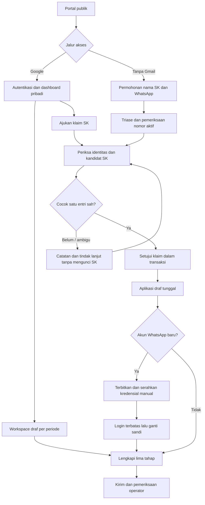
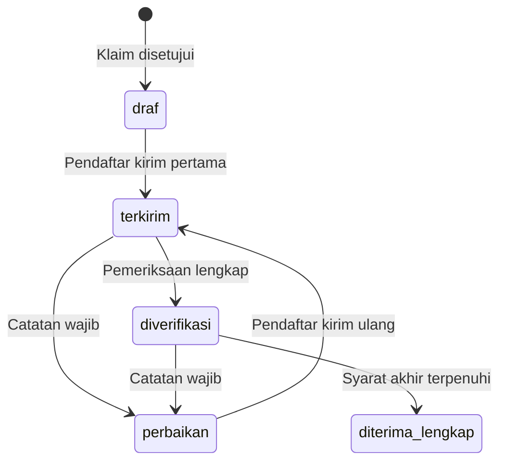

# 02 — Alur bisnis dan aturan status

## 1. Persiapan periode

1. Administrator membuat periode dengan kode unik, nama, waktu buka/tutup WIB, kebijakan revisi, dan pengumuman. Server mengonversi timestamp ke UTC.
2. Administrator menyiapkan akun operator, mengaktifkannya, dan memasukkannya dalam daftar operator periode. Tidak ada asumsi jumlah operator harus empat.
3. Administrator mencatat sumber SK, mengunggah Excel, membaca validasi per baris, memperbaiki kesalahan, dan mengonfirmasi hasil yang masih berlaku.
4. Administrator menugaskan seluruh SK, meninjau peserta tanpa penanggung jawab, memeriksa referensi formulir, serta menetapkan kanal bantuan dan SOP klaim.
5. Periode hanya dapat dipublikasikan setelah konfigurasi PMB minimum dan referensi valid. Neo boleh nonaktif. Sistem memperingatkan SK belum ditugaskan; pembukaan untuk peserta nyata mensyaratkan semua tugas mempunyai penanggung jawab aktif.

Tanggal/jam contoh prototipe tidak otomatis dipakai. Tampilan publik mengikuti periode yang dipilih sebagai periode publik, bukan mengambil periode pertama dari database. Bila beberapa periode dibuka, setiap klaim/draf terikat pilihan periode eksplisit.

## 2. Dua jalur pendaftar

### 2.1 Google

Callback memvalidasi state OAuth dan identitas provider; kegagalan/cancel kembali ke halaman masuk dengan pesan yang dapat ditindaklanjuti. Akun baru mendapat `pendaftar_ppg`. Provider ID yang sudah terikat harus kembali ke user yang sama walau nama/email berubah. Email yang sama dengan akun lokal **tidak** boleh menggabungkan akun otomatis atau menaikkan peran.

Pengelola Google diprovisikan lewat undangan/rekaman izin sekali pakai yang terikat email yang telah diverifikasi provider dan dikonfirmasi administrator, atau lewat pengaitan setelah autentikasi lokal sah. Akun Google publik tidak pernah menjadi pengelola hanya karena memakai domain kampus. Jika identitas bentrok, tahan pengaitan dan arahkan ke administrator.

Dashboard tersedia sebelum klaim, tetapi belum menampilkan nomor PMB atau nama SK orang lain. Workspace dapat diisi sendiri. Operator belum berhak membaca workspace pra-klaim hanya berdasarkan kemiripan nama.

### 2.2 WhatsApp tanpa Gmail

Form publik meminta periode, nama persis SK, nomor WhatsApp, pengenal SK bila tersedia, dan persetujuan pemrosesan klaim. Setelah tersimpan, pengguna mendapat nomor referensi permohonan acak dan respons generik. Nomor referensi bukan autentikasi dan tidak membuka data klaim melalui URL publik.

Sistem menyusun kandidat internal: cocok satu kandidat masuk penugasan operator SK tersebut; kandidat kosong atau lebih dari satu masuk antrean triase admin. Admin dapat menunjuk satu operator penanggung jawab klaim tanpa memberikan akses roster lain. Kandidat sementara tidak memesan atau mengunci kepemilikan SK.

Operator mengonfirmasi nomor aktif melalui balasan di kanal resmi, mencatat bukti, memeriksa identitas, lalu menyetujui SK. Transaksi membuat user `pending_activation`, workspace, dan aplikasi draf; email boleh kosong. Kredensial belum otomatis dianggap diserahkan. Dashboard baru terbuka setelah penyerahan, login sah, dan penggantian sandi pertama.

## 3. Siklus klaim dan persetujuan atomik

Status klaim diusulkan: `pending`, `needs_information`, `approved`, `declined`, `cancelled`. Status ini **bukan** status aplikasi. `declined` berarti kaitan identitas belum dapat diterima, bukan hasil seleksi PMB.

Persetujuan menggunakan urutan kunci konsisten: periode → akun pemilik (bila sudah ada) → peserta SK → klaim → aplikasi → workspace. Alokasi nomor memakai baris sequence setelah lock periode; semua action lain yang menyentuh objek sama mengikuti urutan ini dan boleh melewati objek yang tidak dibutuhkan. Untuk akun baru, buat dalam transaksi dan lindungi kunci unik; urutan daftar ID selalu stabil pada operasi massal. Jangan memanggil layanan eksternal selama lock database dipegang.

Dalam transaksi:

1. Baca ulang status periode, klaim, penugasan terkini, dan bukti pemeriksaan. Klaim `approved` yang sama dikembalikan sebagai hasil lama untuk request ulang.
2. Pastikan operator berhak terhadap kandidat final dan peserta tidak ditarik/diblokir. Jalur WhatsApp mensyaratkan bukti nomor aktif pada nomor permohonan saat ini.
3. Pastikan SK belum dimiliki user lain dan user belum mempunyai aplikasi pada periode itu. Klaim lain pending boleh tetap ada, tetapi harus ditandai perlu tindak lanjut saat objek sudah diklaim.
4. Tetapkan `claimed_user_id`, `approved_claim_id`, dan waktu persetujuan pada SK; buat atau gunakan workspace user/periode.
5. Buat satu aplikasi `draf` dengan nomor PMB unik, hubungkan workspace, dan catat keputusan klaim/aktor. Nomor PMB dibuat saat aplikasi dibentuk; tanggal daftar masih kosong sampai submit.
6. Tulis audit dalam transaksi yang sama. Commit; baru buat notifikasi dashboard/pekerjaan lanjutan sesudah commit.

Jika dua pihak menyetujui SK yang sama, unique constraint dan lock memastikan hanya satu berhasil. Pihak kedua mendapat pesan “Kepesertaan telah berubah; muat ulang pemeriksaan”, tanpa membuka data pemilik lain. Pemindahan kepemilikan sah ke user lain hanya oleh admin, dengan penutupan akses user lama, perpindahan workspace/aplikasi yang konsisten, dan tanpa membuat aplikasi kedua.

## 4. Verifikasi nomor dan serah kredensial

Nomor dinormalisasi ke format internasional (contoh `0812...` menjadi `+62812...`). Simpan sebagai teks, validasi format melalui aturan terpusat, dan jangan menyimpulkan kepemilikan hanya dari kecocokan nomor. Nomor bersama menghasilkan konflik yang dapat diselesaikan admin berdasarkan bukti; tidak otomatis menggabungkan user.

Prosedur yang diusulkan:

1. Operator membuka klaim/aplikasi dalam scope tugas, memeriksa nomor tujuan yang dimasking pada daftar dan terlihat rinci hanya saat diperlukan.
2. Sistem dapat membuat kode tantangan acak; hanya hash kode, target nomor, waktu kedaluwarsa, dan jumlah percobaan yang disimpan. Usulan awal: berlaku 15 menit, maksimum lima percobaan, penerbitan baru membatalkan kode lama. Ini bukan pengiriman API.
3. Operator mengirim kode secara manual dari WhatsApp resmi dan menerima balasan pada percakapan yang sama. Teks tidak meminta NIK penuh atau sandi peserta.
4. Operator memvalidasi jawaban, mencatat waktu balasan dan ringkasan bukti aman. Sistem menyimpan nomor, aktor, metode, dan waktu verifikasi; isi chat penuh tidak disalin.
5. Untuk jalur WhatsApp baru, setelah klaim sah operator menerbitkan `login_id` stabil dan sandi sementara acak. Usulan masa berlaku sandi: 24 jam, panjang sekurangnya 16 karakter acak; nilai disahkan pada keputusan K-03.
6. Sandi tampil **sekali** kepada operator pada respons khusus yang tidak dimasukkan ke snapshot Livewire/localStorage/log. Hanya hash disimpan. Jika halaman tertutup, terbitkan ulang dan cabut yang lama.
7. Operator mengirim manual ke nomor terverifikasi dan menekan “Catat sudah diserahkan”. Simpan aktor, waktu, dan nomor tujuan. Sebelum catatan ini, kredensial tidak dapat dipakai.
8. Login pertama mengonsumsi sandi sementara secara atomik dan membuka sesi aktivasi terbatas. Sesi ini hanya boleh mengganti sandi atau logout; user tetap belum aktif penuh. Timeout sesi aktivasi diusulkan 10 menit. Jika terputus, operator menerbitkan akses baru setelah pemeriksaan.
9. Penggantian sandi menetapkan hash sandi permanen, mengaktifkan user, mencabut issuance/sesi pemulihan lain, merotasi sesi dan token CSRF. Password usulan minimum 12 karakter; konfirmasi wajib. Akun Google yang tidak punya sandi lokal tidak mendapat sandi rekaan.

Usulan pembatasan: login lima percobaan/menit per kombinasi IP + identitas ternormalisasi dan batas agregat per IP; klaim/pencarian sepuluh/menit per IP dengan batas tambahan per target. Angka disesuaikan hasil uji dan jaringan bersama kampus, bukan dikunci dalam UI.

Perubahan nomor menghapus keabsahan verifikasi aktif dalam transaksi yang sama, menyimpan alasan invalidasi dan membuat tindak lanjut operator. Nomor Google juga wajib diverifikasi sebelum diterima lengkap. Jika nomor berubah setelah accepted, gunakan prosedur admin di bagian 7; pendaftar tidak bisa mengubah formulir terkunci.

## 5. State machine aplikasi

`belum_ada` hanya nilai turunan pada baris SK. Database `applications.status` hanya menyimpan lima status berikut.

| Transisi | Pengaman server | Efek tersimpan |
| --- | --- | --- |
| SK tanpa aplikasi → draf | Klaim sah; constraint pemilik; peran/penugasan benar | Aplikasi dan nomor PMB; tanggal daftar belum ada |
| draf → terkirim | Pemilik, periode mengizinkan, SK aktif, seluruh field final valid, pernyataan versi aktif | `submitted_at` UTC sekali, `tanggal_daftar` WIB sekali, snapshot konfigurasi, submit revision, consent |
| terkirim → diverifikasi | Operator/admin berhak; checklist identitas, SK, dan formulir; versi data belum berubah | Review, versi data diperiksa, waktu/aktor verifikasi |
| terkirim/diverifikasi → perbaikan | Catatan spesifik dan daftar kelompok/field; alasan aman untuk pendaftar | Review permintaan perbaikan; checklist sebelumnya tidak cukup untuk keputusan baru |
| perbaikan → terkirim | Pemilik; izin revisi; validasi final ulang; konfirmasi pernyataan ulang | Revisi bertambah, `last_resubmitted_at`, riwayat perubahan; tanggal pertama tetap |
| diverifikasi → diterima_lengkap | Validasi final server, klaim sah, checklist versi terbaru, WA nomor saat ini sah, konflik selesai, tidak diblokir | Keputusan, aktor, waktu diterima, audit; formulir terkunci |

Request mengirim `expected_version`; server mengunci aplikasi dan memeriksa `lock_version`. Konflik versi menghasilkan 409 atau pesan domain ekuivalen pada Livewire. Tidak ada pemaksaan penulisan versi lama. Klik submit dua kali atau retry setelah timeout mengembalikan pengiriman yang sudah tersimpan, tanpa nomor/tanggal/snapshot baru.

## 6. Draf, revisi, dan periode

- Workspace dibuat per user/periode, dengan biodata dan pendidikan asal. Sebelum klaim sah status aplikasi pada UI adalah “Kepesertaan belum disetujui”; label draf workspace tidak boleh dihitung sebagai aplikasi draf resmi.
- Simpan draf mengizinkan kolom belum lengkap, tetapi nilai yang terisi harus benar tipe/formatnya. Server mengembalikan `saved_at` dan versi baru. Pergantian tahap menyimpan setelah validasi kelompok; submit memvalidasi semua tahap lagi.
- Setelah aplikasi terkirim, workspace terkait terkunci. Pada perbaikan, seluruh field formulir pribadi boleh diedit untuk menjaga konsistensi; field yang diminta ditandai. Nama SK, status, operator, NIM, dan konfigurasi tetap tidak dapat diedit pendaftar. Ini keputusan rancangan yang perlu dijelaskan di UI.
- Setiap kirim mencatat revisi dan versi persetujuan. Isi sensitif tidak disalin ke audit umum; simpan snapshot revisi terenkripsi hanya bila diperlukan untuk bukti pemeriksaan, dengan retensi yang disetujui.
- Jadwal efektif: status periode `published`, `opens_at <= now < closes_at`, dan tidak ditutup manual. Diusulkan draf masih boleh disimpan pada periode published yang telah tutup, tetapi kirim pertama dan klaim baru dilarang. Periode archived hanya baca.
- Kirim ulang setelah tutup hanya jika `allow_correction_after_close=true`, status aplikasi perbaikan, dan `now < correction_closes_at`. Deadline revisi wajib jika izin diaktifkan; jangan membiarkan perbaikan tanpa batas. Operator masih dapat menyelesaikan pemeriksaan sesudah penutupan selama periode belum diarsipkan.
- Menutup manual melarang klaim/kirim pertama saat itu juga. Buka kembali harus disertai alasan dan jadwal baru yang valid. Arsip mensyaratkan pekerjaan tertunda diselesaikan/diberi pengecualian; konfigurasi arsip tidak diubah tanpa prosedur admin.

## 7. Kasus pengecualian dan pemulihan

| Kasus | Penanganan |
| --- | --- |
| Nama kembar/beda ejaan | Jangan pilih hasil pertama; admin/operator penanggung jawab meminta pembeda yang sah, lalu menetapkan kandidat final |
| Klaim tidak cocok/sudah dimiliki | Respons publik tetap aman; catatan internal menyimpan alasan dan tindak lanjut; tidak membuat roster baru |
| Salah pemilik sesudah klaim sah | Admin memblokir sementara, mencabut sesi/kredensial terdampak, memeriksa kedua pihak, memperbaiki kaitan secara atomik; riwayat lama tetap |
| Peserta ditarik dari SK | Admin memberi `withdrawn` dan blok administratif; aplikasi/status historis dipertahankan; tidak ada status PMB `ditolak` baru |
| Operator nonaktif | Sesi ditolak segera; admin melihat beban belum dialihkan dan melakukan transfer; operator tidak boleh mengambil tugas sendiri |
| Akun lokal kehilangan akses | Verifikasi ulang identitas dan nomor; admin/operator berhak mencabut issuance/sesi lama lalu menyerahkan akses baru |
| Email Google berubah | Tetap gunakan provider ID; perubahan email kontak disimpan tanpa membuat akun baru atau menimpa email yang bentrok |
| Pengaitan dua akun | Bukti kepemilikan kedua identitas, persetujuan admin, pemeriksaan constraint periode; konflik aplikasi diselesaikan sebelum merge |
| Koreksi setelah diterima lengkap | Admin membuat kasus beralasan; buka kembali melalui transisi khusus `diterima_lengkap → perbaikan`, invalidasi pemeriksaan terkait, versi/bukti baru; tanggal pertama tetap |
| Sudah terkirim Neo lalu perlu koreksi | Blok sinkron ulang; rekonsiliasi admin pada R2. Pembaruan data Neo memerlukan kontrak update yang diuji; jangan insert ulang |

Transisi pembukaan kembali adalah **pengecualian admin**, tidak muncul sebagai tombol keputusan operator biasa. Setiap download bukti setelah pembukaan kembali menampilkan status terbaru; salinan lama dapat berbeda dan diberi waktu cetak/nomor revisi.
