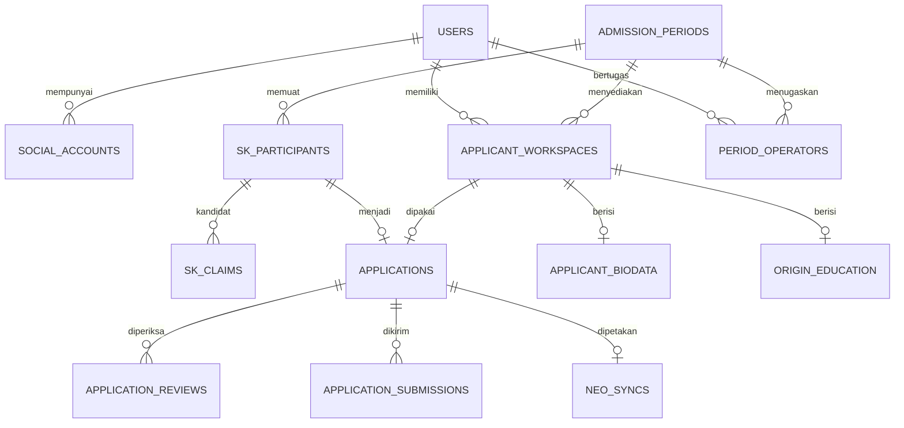

# 04 — Basis data dan kamus data

## 1. Konvensi dan keputusan penyimpanan

Skema berikut adalah **target**, bukan migrasi yang sudah tersedia. Gunakan ID internal bigint, foreign key, timestamp UTC dengan presisi yang konsisten, string UTF-8, dan nomor identitas/kode sebagai teks. `date` untuk tanggal lahir, tanggal SK, dan `tanggal_daftar`. Angka keuangan memakai decimal, bukan float. Status menggunakan string terkontrol oleh enum PHP dan constraint/check yang didukung database target; hindari menambah status melalui input bebas.

Target usulan MySQL/InnoDB harus ditetapkan sebelum F01; SQLite boleh dipakai untuk tes cepat yang tidak menguji konkurensi. Uji lock dan constraint memakai engine target. Panjang yang disebutkan adalah rancangan awal yang cukup untuk formulir, dan harus dicocokkan dengan sumber resmi/kontrak Neo sebelum rilis integrasi.

`applicant_workspaces` menyelesaikan draf pra-klaim. `applicant_biodata` dan `origin_education` terkait workspace, **berbeda dari FK aplikasi pada rancangan MVP lama**. Aplikasi resmi menunjuk satu workspace; formulir tidak disalin ke dua tempat yang dapat berbeda. Kepemilikan workspace/aplikasi/periode selalu diperiksa di action.

## 2. Relasi inti

Relasi ER di atas menunjukkan inti, bukan semua FK. Klaim boleh belum mempunyai kandidat; satu klaim hanya mempunyai satu kandidat final setelah pemeriksaan, sedangkan daftar kemungkinan tetap metadata internal. Operator penanggung jawab klaim ambigu disimpan terpisah dari operator peserta SK.

## 3. Akun, sesi, dan kredensial

| Tabel | Kolom utama / tipe | Constraint dan catatan |
| --- | --- | --- |
| `users` (ubah tabel yang ada) | `id`; `name varchar(255)`; `email varchar(255) NULL`; `login_id varchar(64) NULL`; `password varchar(255) NULL`; `role varchar(32)`; `account_state varchar(32)`; `must_change_password bool`; `last_login_at datetime NULL`; timestamps | Unique email ternormalisasi jika terisi, unique login_id; role tiga nilai; state `pending_activation/active/disabled`; user pending tidak bisa membuka dashboard |
| `social_accounts` | `user_id FK`; `provider varchar(32)`; `provider_user_id varchar(255)`; `provider_email varchar(255) NULL`; `linked_at`; timestamps | Unique `(provider, provider_user_id)`; unique `(user_id, provider)` untuk satu Google per user; tidak menyimpan access/refresh token untuk login dasar |
| `staff_invitations` | `email`; `role`; `token_hash`; `expires_at`; `accepted_at NULL`; `created_by FK`; `accepted_by NULL`; timestamps | Token undangan sekali pakai; email provider diverifikasi; akun baru publik tidak memperoleh peran undangan tanpa proses pengikatan yang sah |
| `credential_issuances` | `user_id`; `claim_id NULL`; `secret_hash varchar(255)`; `purpose`; `target_number varchar(20)`; `issued_by`; `expires_at`; `delivered_at/by NULL`; `used_at NULL`; `revoked_at NULL`; `attempt_count int`; timestamps | Hash bukan sandi jelas; satu issuance aktif per user diatur dengan lock user saat penerbitan; terbit baru mencabut lama; purpose `activation/recovery` |
| `sessions` (sudah ada) | Sesi framework; user ID; activity | Sesi aktivasi memiliki flag server dan batas waktu; pencabutan user/nomor memutus sesi terkait; jangan mengandalkan cookie role |

Nilai sandi sementara tidak disimpan ke tabel audit, session payload, queue, atau browser storage. Sesi aktivasi hanya membawa referensi issuance yang sudah dikonsumsi dan deadline, bukan secret. `password_reset_tokens` bawaan boleh tetap ada, tetapi jalur WhatsApp tidak bergantung pada email reset yang tidak dimiliki peserta.

## 4. Periode, konfigurasi, dan penugasan

| Tabel | Kolom utama / tipe | Constraint dan catatan |
| --- | --- | --- |
| `admission_periods` | `code varchar(40)`; `name varchar(255)`; `academic_year varchar(20)`; `wave varchar(50)`; `state varchar(24)`; `opens_at`; `closes_at`; `manual_closed_at NULL`; `allow_correction_after_close bool`; `correction_closes_at NULL`; `is_public bool`; `lock_version uint`; timestamps | Unique code; state `draft/published/archived`; waktu tutup > buka; deadline revisi sesudah tutup jika diaktifkan; periode publik dipilih eksplisit |
| `admission_config_versions` | `admission_period_id`; `version uint`; `pmb_config json`; `neo_mapping json NULL`; `reference_version_ids json`; `consent_version`; `created_by`; `approved_by/at NULL`; `neo_verified_by/at NULL`; timestamps | Unique `(period_id, version)`; versi yang pernah dipakai tidak diedit; PMB boleh approved walau Neo belum verified |
| `admission_sequences` | `admission_period_id`; `purpose varchar(24)`; `last_number bigint unsigned`; timestamps | Unique `(period_id,purpose)`; lock baris saat alokasi nomor PMB; nomor unik meski dua klaim disetujui bersamaan; bukan janji urutan tanpa celah |
| `period_operators` | `admission_period_id`; `user_id`; `is_active bool`; `sort_order uint`; timestamps | Unique `(period_id,user_id)`; user harus operator aktif; daftar ini sumber pilihan pembagian otomatis |
| `assignment_events` | `sk_participant_id`; `old_operator_id NULL`; `new_operator_id NULL`; `reason text`; `mode varchar(24)`; `batch_id NULL`; `actor_id`; `created_at` | Append-only; mode `explicit/automatic/transfer/rebalance`; penghapusan user bersejarah dibatasi |
| `assignment_batches` | `admission_period_id`; `operator_ids json`; `preview_hash`; `period_version`; `state`; `created_by`; `confirmed_at NULL`; timestamps | Mengikat pratinjau pada peserta/operator/versi yang sama; batch stale tidak boleh diterapkan diam-diam |

Sumber penugasan kini hanya `sk_participants.assigned_operator_id`; aplikasi tidak memiliki salinan operator aktif yang bisa tertinggal. Nama operator pada bukti dapat diambil dari relasi saat cetak; histori pemeriksaan menyimpan aktor saat aksi.

## 5. Impor, peserta resmi, dan klaim

| Tabel | Kolom utama / tipe | Constraint dan catatan |
| --- | --- | --- |
| `sk_imports` | `admission_period_id`; `original_filename`; `private_path`; `file_sha256 char(64)`; `template_version`; `state`; `counts json`; `preview_hash char(64) NULL`; `dataset_version`; `uploaded_by`; `validated_at/committed_at/expires_at NULL`; timestamps | State `uploaded/validating/invalid/ready/stale/committed/failed/expired`; hash file bukan satu-satunya pemeriksaan idempotensi baris |
| `sk_import_rows` | `sk_import_id`; `sheet_name`; `row_number uint`; `normalized_payload json`; `row_key`; `row_hash char(64)`; `result`; `errors json NULL`; `matched_participant_id NULL` | Unique `(import_id,sheet_name,row_number)`; staging internal; payload hanya field template; hasil `new/identical/change/conflict/error` |
| `sk_participants` | `admission_period_id`; `sk_number varchar(150)`; `sk_date date`; `sk_order uint`; `official_participant_id varchar(100) NULL`; `name_on_sk varchar(255)`; `normalized_name varchar(255)`; `assigned_operator_id FK NULL`; `claimed_user_id FK NULL`; `approved_claim_id FK NULL`; `roster_state`; `admin_hold bool`; `hold_reason NULL`; `internal_note text NULL`; `last_import_id`; `lock_version uint`; timestamps | Unique `(period_id, sk_number, sk_order)`; pengenal resmi unik per periode jika terisi; nama tidak unik; roster state `active/withdrawn`; claimed_user dan approved_claim konsisten |
| `sk_claims` | `admission_period_id`; `candidate_sk_participant_id FK NULL`; `requester_user_id FK NULL`; `submitted_name varchar(255)`; `submitted_identifier varchar(100) NULL`; `whatsapp_number varchar(20)`; `access_path varchar(16)`; `status varchar(24)`; `review_owner_id FK NULL`; `public_reference varchar(64)`; `request_key varchar(64)`; `public_note/internal_note NULL`; `reviewed_by/at NULL`; `lock_version uint`; timestamps | Unique public_reference dan request_key; Google requester wajib; WhatsApp user boleh NULL sebelum persetujuan; status terpisah dari aplikasi; publik tidak boleh query klaim dengan ID urut |
| `whatsapp_verifications` | `claim_id FK NULL`; `workspace_id FK NULL`; `source_verification_id FK NULL`; `number varchar(20)`; `challenge_hash NULL`; `challenge_expires_at NULL`; `attempt_count`; `method`; `reply_received_at NULL`; `verified_at/by NULL`; `evidence_summary text NULL`; `invalidated_at/reason NULL`; timestamps | Verifikasi mempunyai tepat satu target awal: klaim atau workspace; nomor harus sama dengan target terkini; bukti klaim dapat menjadi dasar verifikasi workspace sesudah approval melalui source_verification_id yang sah |

Jangan memasang unique nomor WhatsApp: nomor keluarga/bersama harus ditinjau. Simpan status konflik pada kasus administratif yang dapat ditutup admin; pemeriksaan konflik adalah prasyarat approval/final sesuai kasus. `approved_claim_id` ditambahkan setelah tabel klaim dibuat karena FK membentuk siklus.

## 6. Workspace, aplikasi, pemeriksaan, dan bukti

| Tabel | Kolom utama / tipe | Constraint dan catatan |
| --- | --- | --- |
| `applicant_workspaces` | `user_id`; `admission_period_id`; `saved_at NULL`; `lock_version uint`; timestamps | Unique `(user_id,period_id)`; hanya pemilik dapat menulis sebelum aplikasi; dapat kosong sebelum biodata diisi |
| `applicant_biodata` | `workspace_id`; field pada bagian 7; `current_whatsapp_verification_id NULL`; timestamps | Unique workspace_id; current verification harus milik target/nomor yang sama dan belum invalidated |
| `origin_education` | `workspace_id`; `reference_dataset_id NULL`; `pt_external_id varchar(64) NULL`; `pt_name_snapshot varchar(255) NULL`; `prodi_external_id varchar(64) NULL`; `prodi_name_snapshot varchar(255) NULL`; timestamps | Unique workspace_id; kosong pada draf; pasangan dan snapshot diambil dari dataset server |
| `applications` | `application_number varchar(64)`; `sk_participant_id`; `user_id`; `admission_period_id`; `workspace_id`; `status varchar(24)`; `submitted_at datetime NULL`; `tanggal_daftar date NULL`; `last_resubmitted_at NULL`; `accepted_at/by NULL`; `config_version_id NULL`; `config_snapshot json NULL`; `lock_version uint`; `nim varchar(50) NULL`; timestamps | Unique SK, workspace, nomor aplikasi, `(user_id,period_id)`; NIM unique bila terisi sesuai lingkup institusi yang disahkan; hanya lima status tersimpan |
| `application_submissions` | `application_id`; `revision uint`; `submitted_by`; `submitted_at`; `workspace_version`; `config_version_id`; `consent_record_id`; `content_digest`; `encrypted_snapshot text NULL`; timestamps | Unique `(application_id,revision)`; digest untuk integritas, bukan tempat menyimpan biodata; snapshot bila diaktifkan dienkripsi dan tidak dipublikasikan |
| `application_reviews` | `application_id`; `submission_revision`; `reviewer_id`; `action`; `identity_checked bool`; `sk_checked bool`; `data_checked bool`; `field_keys json`; `public_note NULL`; `internal_note NULL`; `expected_version`; `created_at` | Append-only; reviewer dan revisi yang diperiksa jelas; `request_correction` wajib public_note dan field_keys |
| `administrative_cases` | `period_id`; `participant_id NULL`; `claim_id NULL`; `application_id NULL`; `type`; `state`; `reason`; `owner_id`; `opened_by`; `resolved_by/at NULL`; `resolution NULL`; timestamps | Untuk nama ambigu, nomor bersama, penarikan, pemindahan kepemilikan, pembukaan kembali, koreksi pasca-Neo; bukan status ketujuh aplikasi |
| `consent_texts` | `purpose`; `version varchar(40)`; `body text`; `content_hash`; `published_at`; `created_by` | Unique `(purpose,version)`; naskah yang dipakai tidak diedit; purpose klaim/submission/account-link |
| `consent_records` | `consent_text_id`; `user_id NULL`; `claim_id NULL`; `application_id NULL`; `revision NULL`; `accepted_at`; `request_id`; `ip_digest NULL` | Klaim publik boleh belum ada user; tepat satu konteks consent; IP opsional dan retensinya disahkan |

`config_snapshot` dibekukan pada submit pertama. Pada revisi berikutnya, simpan rujukan konfigurasi yang digunakan tanpa menimpa snapshot awal. Pemetaan Neo yang dilengkapi belakangan memakai snapshot integrasi terpisah pada `neo_syncs`. Admin tidak menulis NIM melalui field formulir pendaftar.

## 7. Kamus field formulir

Semua field biodata boleh NULL pada draf kecuali relasi. Kolom wajib di bawah berarti **wajib saat kirim** sesuai rancangan awal; pengesahan pengelola dicatat pada K-05. Nama field JS prototipe diterjemahkan pada batas UI; database menggunakan snake_case yang konsisten.

| Field demo → kolom target | Tipe/logika penyimpanan | Aturan final |
| --- | --- | --- |
| `name` → `full_name` | varchar(255) | Wajib, trim, tidak diubah mengikuti nama Google; beda nama SK menjadi indikator pemeriksaan |
| `gender` → `gender_code` | varchar(10) referensi | Wajib; simpan kode referensi, label Indonesia pada UI |
| `birthplace` → `birth_place` | varchar(100) | Wajib; teks valid |
| `birthdate` → `birth_date` | date | Wajib, tanggal sah, sebelum hari ini; batas usia belum ditetapkan |
| `nik` → `nik_encrypted` | text terenkripsi; plaintext logis tepat 16 digit | Wajib; tidak integer; tidak memvalidasi kepemilikan Dukcapil hanya dari pola |
| `nisn` → `nisn_encrypted` | text terenkripsi; plaintext logis 10 digit | Opsional jika belum tersedia; jika terisi harus 10 digit; kewajiban Neo dikonfirmasi |
| `religion` → `religion_code` | varchar(20) referensi | Wajib; daftar tidak dibatasi dua nilai demo tanpa kebijakan |
| `nationality` → `nationality_code` | varchar(10) referensi | Wajib; “Lainnya” bukan nilai kontrak eksternal |
| `mother` → `mother_name_encrypted` | text terenkripsi; panjang logis 255 | Wajib; hanya detail berizin dapat membaca |
| `wa` → `whatsapp_number` | varchar(20) internasional | Wajib; normalisasi dan format; verifikasi aktif dijaga terpisah |
| `email` → `contact_email` | varchar(255) | Opsional; bila terisi format email; tidak otomatis mengubah email login/provider |
| `phone` → `other_phone` | varchar(20) NULL | Opsional; format nomor, bukan integer |
| `street` → `street_address` | varchar(255) | Wajib |
| `hamlet` → `hamlet` | varchar(100) NULL | Opsional; kosong tetap NULL, bukan tanda strip rekaan |
| `rt`, `rw` → `rt`, `rw` | varchar(5) NULL | Opsional; digit jika terisi; pertahankan nol awal |
| `village` → `village_name` | varchar(150) | Wajib sesuai UI; jika dataset desa tersedia tambahkan ID dengan relasi yang sah |
| `province`, `city`, `district` → `province_code`, `city_code`, `district_code` | varchar(20) referensi wilayah | Wajib; kota milik provinsi dan kecamatan milik kota |
| `postal` → `postal_code` | varchar(10) NULL | Opsional; aturan negara/referensi disahkan, jangan memotong nol awal |
| `residence` → `residence_type_code` | varchar(20) referensi | Wajib |
| `transport` → `transport_type_code` | varchar(20) referensi | Wajib |
| `kps` → `is_kps_recipient` | boolean nullable | Wajib memilih ya/tidak pada final; jangan menganggap belum memilih = tidak |
| `kpsNumber` → `kps_number_encrypted` | text NULL; panjang logis 100 | Wajib jika KPS ya; NULL jika tidak |
| `npwp` → `npwp_encrypted` | text NULL; panjang logis 40 | Opsional; format sesuai kontrak aktif; jangan menolak memakai pola historis yang belum diverifikasi |
| `needs` → `special_need_code` | varchar(20) referensi | Pilihan eksplisit tidak ada/ada; nilai final mengikuti referensi, bukan string label |
| `university`, `study` → `origin_education.*` | ID teks + nama snapshot | Wajib PT/prodi aktif sesuai dataset; bukan label bebas dari request |

ID referensi dan kode wilayah bukan angka hitung. Hindari indeks langsung pada ciphertext. Jika pencarian deduplikasi NIK sungguh diperlukan, tambahkan keyed HMAC dengan secret terpisah dan alasan penggunaan, bukan plaintext atau hash biasa yang mudah ditebak; fitur itu belum menjadi keharusan MVP.

## 8. Referensi, audit, ekspor, dan Neo

| Tabel | Kolom utama | Aturan |
| --- | --- | --- |
| `reference_datasets` | `type`, `version`, `source`, `state`, `activated_at`, `created_by` | State staging/active/retired; aktivasi atomik setelah semua halaman valid |
| `reference_options` | `dataset_id`, `group`, `code`, `label`, `is_active`, `parent_code NULL` | Unique dataset+group+code; agama, negara, tinggal, transportasi, KPS/kebutuhan khusus sesuai sumber |
| `reference_regions` | `dataset_id`, `code`, `level`, `parent_code NULL`, `name`, `external_mapping NULL` | Unique dataset+code; level province/city/district; wilayah internal dipetakan ke Neo bila kode berbeda |
| `reference_pt` | `dataset_id`, `external_id`, `code NULL`, `name`, `is_active` | Unique dataset+external_id; simpan semua halaman sumber |
| `reference_prodi` | `dataset_id`, `external_id`, `pt_external_id`, `code NULL`, `name`, `is_active` | Unique dataset+external_id; pasangan PT harus ada pada dataset yang sama |
| `reference_sync_runs` | `type`, `dataset_id NULL`, `state`, `page/row counts`, `started_at`, `finished_at`, `error_code`, `safe_summary`, `actor_id` | Run gagal tidak mengganti dataset aktif |
| `audit_events` | `actor_id NULL`, `actor_role_snapshot`, `action`, `subject_type/id`, `period_id NULL`, `request_id`, `safe_changes json`, `reason NULL`, `created_at` | Append-only; sistem/job memiliki aktor pengaju dan penanda sistem; tidak menyalin secret/biodata penuh |
| `export_runs` | `requested_by`, `scope_snapshot json`, `column_set`, `row_count`, `state`, `private_path NULL`, `expires_at`, timestamps | Download memeriksa ulang izin saat itu; file privat, kedaluwarsa, audit permintaan/download |
| `application_settings` | `key`, `value json`, `version`, `updated_by` | Hanya pengaturan tampilan/layanan yang diizinkan; secret bukan JSON yang dikirim ke browser |
| `neo_syncs` (R2) | `application_id`, `state`, `mapping_snapshot json`, `payload_hash`, `submission_revision`, `biodata_state`, `history_state`, `neo_student_id NULL`, `neo_history_id NULL`, `verified_at NULL`, `requested_by`, `lock_version` | Unique application_id; status Neo independen; ID eksternal varchar(64); satu proses aktif per aplikasi |
| `neo_sync_attempts` (R2) | `neo_sync_id`, `step`, `attempt_no`, `request_hash`, `outcome`, `error_code`, `safe_response`, `started_at`, `finished_at`, `request_id` | Unique sync+step+attempt; tidak menyimpan token/raw payload sensitif |

Nama singkat seperti `page/row counts` mewakili kolom hitung terpisah (`pages_received`, `rows_received`, `rows_valid`); jangan membuat nama kolom dengan garis miring. Skema fisik final dibuat lewat migration pada tahapan 07.

## 9. Indeks dan konsistensi

Indeks harus diuji dengan query nyata; daftar awal:

- SK: unique business key; `(admission_period_id, assigned_operator_id, id)` untuk scope; `(admission_period_id, normalized_name)` untuk kandidat internal.
- Aplikasi: seluruh unique pada bagian 6; `(admission_period_id,status,submitted_at,id)` untuk antrean admin; relasi SK mengendalikan scope operator.
- Klaim: `(admission_period_id,status,review_owner_id,created_at,id)` dan kandidat; nomor diindeks untuk pemeriksaan konflik hanya jika rencana query memerlukan.
- Review/submission: `(application_id,created_at,id)`; submission unique revision.
- Audit: `(period_id,created_at,id)` dan `(actor_id,created_at,id)`; ekspor tidak memuat semua event sekaligus ke memori.
- Referensi: PT/prodi pada dataset aktif dan parent; jangan memasang unique nama PT/prodi.

FK lintas tabel tidak otomatis menjamin periode/owner yang sama. Action harus memeriksa `application.user_id = workspace.user_id = participant.claimed_user_id` dan periode seluruh objek sama; tambahkan composite constraint jika engine dan struktur migrasi memungkinkan. Uji perilaku ini secara eksplisit. Semua perubahan kepemilikan memakai transaksi dan kunci yang sama.

Gunakan `restrict` pada penghapusan user/periode/SK/aplikasi yang mempunyai histori. Penonaktifan/arsip menggantikan hard delete rutin. Detail sementara impor boleh dibersihkan setelah retensi tanpa menghapus ringkasan audit. Jangan memakai soft delete untuk menghindari constraint aplikasi tunggal; pemulihan tidak boleh membuat dua aplikasi aktif.

## 10. Urutan migrasi dan seed

1. Tambah role/state/login_id dan ubah nullable email/password pada users melalui migrasi tambahan; jangan menulis ulang migrasi yang sudah pernah dipakai bersama.
2. Buat periode, versi konfigurasi, sequence nomor, operator periode, consent texts, settings, dan undangan/social/credential (FK claim ditunda).
3. Buat dataset/referensi dan run, workspace/biodata/pendidikan.
4. Buat import/header rows, peserta SK tanpa FK approved_claim, lalu klaim. Tambah FK siklus pada migrasi lanjutan.
5. Buat aplikasi, consent records, submission, reviews, kasus admin, verifikasi WA; tambah pointer current verification setelah tabel tersedia.
6. Buat batch/event penugasan, audit, export runs. Tambah indeks berdasarkan query akhir. R2 menambah Neo tanpa mengubah status PMB.
7. Seed hanya referensi sah, naskah/pengaturan awal, dan admin bootstrap lewat perintah aman. Data demo/factory hanya lokal/testing; tidak ada sandi admin tetap di seeder produksi.

Uji migrate dari database kosong dan upgrade dari fondasi saat ini. Untuk produksi, perubahan kolom wajib/unique pada data terisi memerlukan backfill tervalidasi sebelum constraint. Rollback yang menghapus data bukan rencana pemulihan; gunakan backup atau forward fix.
