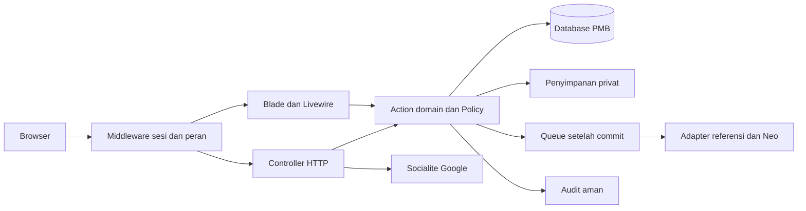

# 05 — Arsitektur dan kontrak aplikasi

## 1. Bentuk aplikasi

Gunakan satu aplikasi Laravel dengan modul domain yang jelas. Ini mencukupi skenario ratusan/ribuan peserta tanpa menambah layanan terpisah. Halaman publik bersifat Blade; workspace interaktif memakai Livewire 4; redirect/callback Google, login/logout, download, dan respons sensitif sekali tampil memakai controller HTTP.

Lapisan tampilan memakai **Bootstrap 5 dan Bootstrap Icons**, dengan CSS khusus PPG dari prototipe sebagai acuan. Vite/Vite Plus tetap digunakan untuk build aset Bootstrap/CSS/JavaScript. Dependensi dan plugin Tailwind pada starter awal dihapus saat implementasi frontend, termasuk import CSS dan utilitas pada halaman bawaan yang masih digunakan. Pagination Laravel diatur memakai view Bootstrap; pagination Livewire juga memakai tema/view Bootstrap agar tidak menghasilkan markup Tailwind.

Fondasi framework yang sudah ada dipakai, tetapi domain PMB belum mempunyai pola implementasi yang mapan. Tetapkan SFC Livewire 4 sebagai format awal, mengikuti default skill/proyek; jangan membuat format kedua tanpa kebutuhan. Logika transaksi, state machine, dan integrasi tetap dalam action/service yang dapat dipanggil controller maupun Livewire.

## 2. Struktur sasaran

| Lokasi | Tanggung jawab / contoh sasaran |
| --- | --- |
| `app/Enums/` | `UserRole`, `AccountState`, `ApplicationStatus`, `ClaimStatus`, `NeoSyncStatus` |
| `app/Models/` | Entitas pada 04; relationships/casts/scopes, bukan tempat alur UI |
| `app/Actions/Admissions/` | `ApproveClaim`, `SaveApplicantDraft`, `SubmitApplication`, `RequestCorrection`, `VerifyApplication`, `AcceptApplication`, `ReopenApplication` |
| `app/Actions/Assignments/` | `PreviewAssignment`, `ApplyAssignment`, `TransferAssignment` |
| `app/Actions/Auth/` | `ResolveGoogleIdentity`, `IssueTemporaryCredential`, `RecordCredentialDelivery`, `ConsumeTemporaryCredential`, `CompleteActivation`, `RevokeAccountAccess` |
| `app/Actions/Imports/` | `ValidateSkImport`, `CommitSkImport` |
| `app/Policies/` | `ApplicationPolicy`, `SkParticipantPolicy`, `SkClaimPolicy`, `AdmissionPeriodPolicy`, `ImportPolicy`, `NeoSyncPolicy`, `ExportPolicy` |
| `app/Http/Controllers/` | Auth, OAuth, undangan, template/download/cetak/ekspor, respons secret sekali tampil |
| `app/Http/Requests/` | Payload controller; misalnya `StorePublicClaimRequest`, `StoreSkImportRequest`, `LocalLoginRequest` |
| `app/Validation/` dan `app/Rules/` | Aturan draft/submit bersama, pasangan referensi, nomor WA; Livewire tidak dipaksa memakai HTTP FormRequest |
| `app/Services/References/`, `app/Services/Neo/` | Batas parsing dan adapter eksternal; hanya Neo memakai kontrak interface untuk fake transport yang bermakna |
| `app/Jobs/` | `ValidateSkImportJob`, `RefreshReferenceDatasetJob`, `GenerateParticipantExportJob`, `SyncApplicationToNeoJob`, `ReconcileNeoSyncJob` |
| `resources/views/layouts/`, `components/` | Layout publik/portal berbasis Bootstrap, badge, tabel, modal, field, timeline, SFC komponen kecil |
| `resources/views/pages/` | Full-page SFC dengan nama namespace `pages::...`, awalan berkas `⚡` sesuai konfigurasi generator yang berlaku |
| `resources/views/print/` | Bukti A4 Blade tersendiri |
| `routes/web.php`, `routes/console.php` | Route web dan jadwal pembersihan/rekonsiliasi; periksa middleware di `bootstrap/app.php` |
| `config/pmb.php`, `config/services.php`, `config/neo.php` | Batas unggah/rate, provider, endpoint server/feature flag; env hanya dibaca dari config |
| `tests/Feature/{Auth,Admissions,Claims,Imports,Assignments,References,Neo}/` | Perilaku domain melalui request/Livewire; tes unit hanya algoritme murni |

Nama berkas adalah rancangan kerja, bukan klaim bahwa semua class sudah ada. Tidak perlu repository generik untuk setiap model atau event untuk setiap klik. Gunakan Eloquent/query builder langsung melalui action yang relevan.

## 3. Middleware dan policy

Kelompok route pribadi: `auth` → akun aktif/sesi aktivasi yang sesuai → role → periode/objek sesuai kebutuhan. Rute aktivasi memakai middleware khusus yang menolak dashboard dan membolehkan perubahan sandi/logout. Semua mutasi lewat web memakai proteksi CSRF.

Policy pendaftar memeriksa owner; policy operator membaca relasi penugasan SK **terkini**, user aktif, dan operator periode aktif. Policy klaim ambigu memeriksa `review_owner_id` yang ditetapkan admin. Admin mempunyai kemampuan lebih luas tetapi tetap mengikuti invariant dan validasi domain; jangan memberikan bypass state machine menyeluruh.

Komponen Livewire tidak boleh mempercayai `user_id`, `role`, `status`, ID kandidat final, kode referensi, harga, waktu, atau checklist hasil perhitungan browser. Validasi dan otorisasi di setiap aksi, bukan hanya `mount`. ID properti dikunci bila sesuai, lalu model tetap diambil ulang dari scope server. Argumen action adalah input tidak tepercaya. Referensi: [Livewire 4 Security](https://livewire.laravel.com/docs/4.x/security).

## 4. Route halaman yang diusulkan

Semua route berikut **belum ada**, selain `/` yang masih halaman welcome. Route personal tidak memerlukan ID user pada URL. Periode dipilih eksplisit dan server memeriksa aksesnya.

| Kelompok | GET halaman |
| --- | --- |
| Publik | `/`, `/panduan`, `/masuk`, `/klaim-whatsapp`, `/pemulihan` |
| OAuth | `/auth/google/redirect`, `/auth/google/callback` |
| Aktivasi | `/aktivasi-sandi`; akses hanya sesi aktivasi belum kedaluwarsa |
| Pendaftar | `/pendaftar`, `/pendaftar/kepesertaan`, `/pendaftar/formulir`, `/pendaftar/status`, `/pendaftar/bukti`, `/pendaftar/bantuan` |
| Operator | `/operator`, `/operator/antrean`, `/operator/peserta`, `/operator/klaim`, `/operator/pendaftaran/{application}`, `/operator/riwayat` |
| Admin | `/admin`, `/admin/peserta-sk`, `/admin/impor`, `/admin/penugasan`, `/admin/antrean`, `/admin/klaim`, `/admin/pendaftaran/{application}`, `/admin/pengguna`, `/admin/periode`, `/admin/referensi`, `/admin/neo`, `/admin/audit`, `/admin/pengaturan` |
| Bersama | `/akun`, `/akun/keamanan`; navigasi mengikuti peran sesi |

Route model binding tidak menggantikan policy. ID numerik boleh dipakai pada portal internal jika query discope; public reference klaim bersifat acak. Tidak ada route yang menerima query `role` untuk mengubah hak akses.

## 5. Kontrak mutasi dan download

Tabel ini adalah kontrak bisnis. Aksi yang dinyatakan **Livewire** dipanggil melalui endpoint update framework, bukan diwajibkan menambah REST API duplikat. HTTP digunakan untuk batas yang membutuhkannya.

| Operasi | Transport / input minimum | Keluaran dan pengaman |
| --- | --- | --- |
| Masuk/keluar | POST `/masuk`, POST `/keluar`; login_id/sandi atau identitas staff yang diizinkan | Rotasi sesi; error generik; limit; tidak memakai GET untuk logout |
| Klaim publik | POST `/klaim-whatsapp`; periode,nama,WA,pengenal,consent,request_key | Referensi acak; response sukses aman; request_key sama tidak membuat klaim baru |
| Pencocokan publik | POST `/cek-kepesertaan`; nama,pengenal,periode | Respons generik; tidak mengirim roster ke browser; throttle |
| Klaim Google | Livewire `submitClaim`; nama,pengenal,WA,periode,request_key | Pemilik sesi sebagai requester; satu pending identik dikembalikan |
| Simpan draf | Livewire `saveDraft`; group,field allowlist,expected_version | saved_at, versi, error field; aplikasi terkunci menolak tulis |
| Kirim/kirim ulang | Livewire `submit`; expected_version,consent_version,accepted | status,tanggal pertama,revisi,versi; idempotensi per aplikasi/status |
| Periksa klaim | Livewire `approveClaim/returnClaim`; claim_id,kandidat final,versi,checklist,catatan | Aplikasi tunggal atau kebutuhan informasi; policy dan transaksi |
| Verifikasi WA | Livewire `verifyWhatsapp`; target,nomor/versi,kode jawaban bila metode kode,bukti | Referensi verifikasi; kode jawaban tidak di-log; nomor dibaca ulang server |
| Terbitkan sandi sementara | POST `/pengelola/klaim/{claim}/kredensial`; expected_version,reason | Halaman respons privat sekali tampil `no-store`; policy tugas/admin, bukan secret dalam state Livewire |
| Catat penyerahan | POST `/pengelola/kredensial/{issuance}/penyerahan`; konfirmasi,versi | delivered_at/by; target nomor masih terverifikasi; issuance tidak kedaluwarsa/dicabut |
| Ganti sandi awal | POST `/aktivasi-sandi`; password,confirmation | User aktif dan sesi baru; issuance sekali pakai |
| Pemeriksaan/status | Livewire `verify/requestCorrection/accept`; application_id,expected_version,checklist,field_keys,note | Transisi valid, review, versi baru; actor sesi |
| Buka kembali/transfer pemilik | Livewire admin; alasan,kasus,versi,target | Transaksi, invalidasi akses/bukti terkait, audit; tidak tersedia pada operator |
| Unggah/commit SK | POST `/admin/impor`; file,periode; Livewire `commitImport` dengan import_id,preview_hash,versi | Run validasi; commit atomik/no-op identik; stale perlu pratinjau ulang |
| Pembagian/transfer | Livewire preview/apply; batch/hash/operator_ids/expected_version,reason | Beban lama/baru; lock periode; current assignment diperiksa ulang |
| Ekspor | Livewire request export; filter,kolom; GET `/ekspor/{export}/unduh` | Run privat; download cek izin/scope terkini; audit; link tidak permanen |
| Template/cetak | GET `/admin/template-sk`; GET `/pendaftar/bukti/cetak` | Template versi saat ini; bukti memeriksa submit dan kepemilikan |
| Neo R2 | Livewire admin preview/dispatch/reconcile/retry; application_id,revision,mapping_hash,reason | Job ID dan state terpisah; flag+policy+readiness; token tidak ke browser |

Respons controller dapat berupa redirect dengan flash/error bag. Status HTTP JSON bila dipakai: 422 untuk validasi, 403 kemampuan ditolak, 404 objek di luar scope, 409 versi/keadaan berubah, 429 limit, 503 dependensi sementara gagal. Livewire memakai error bag/pesan domain ekuivalen, tidak diasumsikan semua kegagalan domain mengubah HTTP update menjadi 409.

## 6. Kontrak action domain

Setiap action menerima aktor nyata, ID objek, payload tervalidasi, dan expected_version bila mutable. Controller/komponen melakukan validasi bentuk, sementara action mengecek invariant, mengunci data, dan memvalidasi keadaan terbaru. Gunakan pola nama/pemanggilan yang sama pada semua action, misalnya `handle(...)` dengan hasil bertipe.

| Action kritis | Transaksi dan hasil |
| --- | --- |
| `ApproveClaim` | Lock periode/user/SK/klaim, cek scope terkini, unique owner, buat akun/workspace/aplikasi bila perlu, approve, audit; hasil application_id |
| `SaveApplicantDraft` | Lock aplikasi terkait lalu workspace sesuai urutan kanonik pada 02, cek status/waktu, update field allowlist, invalidasi WA jika berubah, naikkan versi |
| `SubmitApplication` | Lock periode/aplikasi/workspace; full validation; tetapkan tanggal/snapshot sekali; simpan consent/submission; status; audit |
| `AcceptApplication` | Lock objek SK/aplikasi/workspace sesuai urutan kanonik pada 02; cek revisi pemeriksaan, WA, hold dan referensi; keputusan+review+audit atomik |
| `CommitSkImport` | Lock periode dan staging; bandingkan dataset version/hash; semua row commit atau batal; hitungan dan audit konsisten |
| `ApplyAssignment` | Lock periode; verifikasi batch dan operator aktif; update peserta serta assignment_events satu transaksi |

Jangan menunggu Google/WhatsApp/Neo di dalam transaksi database. Audit mutasi penting ditulis pada transaksi yang sama; notifikasi dan queue dikirim sesudah commit. Event tidak boleh membuat perubahan domain yang tidak terlihat oleh pemanggil.

## 7. Query, queue, dan kegagalan

Daftar memakai query server dan pagination, eager loading relasi yang ditampilkan, urutan stabil dengan ID sebagai tie-breaker. Filter/sort memakai allowlist; jangan memakai nama kolom mentah dari query string. Dashboard menggunakan agregat, bukan memuat seluruh biodata. Cache informasi publik/referensi boleh digunakan dengan invalidasi saat versi berubah; hak akses tidak boleh tertahan cache penugasan lama.

Impor validasi, ekspor besar, pemutakhiran referensi, dan Neo memakai queue durable. Job membawa ID/aktor, bukan seluruh biodata atau secret. Job memuat ulang scope dan keadaan; job ekspor pengguna yang sudah nonaktif harus gagal aman. Timeout dan jumlah retry dicatat per jenis pekerjaan. Job Neo tidak memakai blind retry untuk operasi insert dengan hasil ambigu; lihat 06.

Tangani exception domain sebagai pesan aman, simpan request/correlation ID, dan laporkan exception teknis ke log yang disanitasi. Jangan mengembalikan stack trace, SQL, path privat, kredensial, atau isi respons Neo mentah ke pendaftar. Konfigurasi secret hanya pada server; endpoint eksternal tidak boleh berupa URL bebas dari input peserta atau URL publik tanpa pembatasan admin.

## 8. Perlindungan data dan akun

- HTTPS; cookie Secure/HttpOnly/SameSite sesuai alur OAuth; sesi dirotasi setelah login, aktivasi, dan perubahan hak akses.
- Hash sandi framework; autentikasi ulang untuk ganti sandi, pengaitan provider, dan aksi administratif yang memerlukan pembuktian baru.
- Output Blade di-escape. Pengumuman/FAQ awal memakai teks aman; HTML kaya hanya jika ada sanitizer yang memang diperlukan.
- Unggahan `.xlsx` disimpan privat dengan nama acak; verifikasi isi/ekstensi/ukuran; jangan menjalankan formula atau mengunduh external link workbook.
- Kolom sensitif memakai enkripsi terpilih serta masking daftar; minimalkan data yang dihidrasi ke browser. Enkripsi tidak menggantikan policy.
- Sistem tidak menyediakan pendaftaran operator/admin publik. Admin terakhir yang aktif tidak boleh dinonaktifkan/didemote sebelum pengganti sah tersedia.
- Audit tidak menyimpan payload request mentah. Pelaporan error harus menghapus password, token, kode tantangan, NIK/NISN penuh, dan data keluarga.

Policy dan action dirancang mengikuti [mekanisme otorisasi Laravel](https://laravel.com/framework/docs/13.x/authorization); matriks hak akses spesifik proyek berada pada 01.
